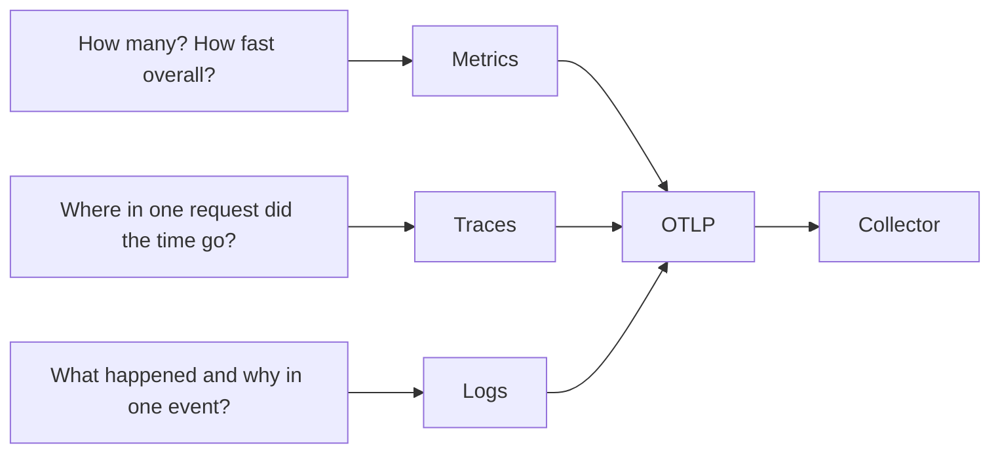

# Metrics, Traces And Logs: What Each Signal Records

A team runs a service named `bridge` in the `starfleet` namespace. Customers say that placing an order is slow. The team has three kinds of data about the service, and each kind can answer a different part of the question. This part explains what each kind records, so that the right one is read first.

Telemetry is data that a running program emits about its own behavior. OpenTelemetry defines three signals: metrics, traces and logs. A signal is a type of telemetry with its own data model. All three signals travel over the same protocol, the OpenTelemetry Protocol (OTLP), which the OpenTelemetry Collector can receive.

## Metrics

A metric is a measurement that is aggregated before it leaves the program. The program does not report every request. It reports a number that summarizes many requests over a period of time.

A program creates a metric through an **instrument**. The common instruments are:

- A **counter** only goes up. It counts things that happen, such as processed orders.
- An **up-down counter** goes up and down. It counts things that can be removed again, such as items in a queue.
- A **gauge** records the current value of something, such as the temperature of a processor or the size of a cache.
- A **histogram** records the distribution of values, such as request durations.

The instrument produces **data points**. A data point has a value, a timestamp and a set of **attributes**, which are key-value pairs that name the population the value describes. A counter data point with the attribute `route=/orders` counts only requests for that route.

A counter and a histogram have an **aggregation temporality**. With cumulative temporality, each data point is the total since a start time. With delta temporality, each data point is the change since the previous data point. A backend that expects one of the two shows wrong values when it receives the other.

A histogram data point holds a count, a sum and the number of values that fell into each bucket. The bucket boundaries are chosen by the program or by a view. From such a point you can estimate a percentile, but you cannot recover a single request duration.

## Traces

A trace describes one request as it moves through a system. It is made of **spans**. A span records one operation that has a start and an end. A span has these fields:

- A **trace ID** shared by every span of the same request, and a **span ID** unique to the span.
- A **parent span ID**. A span without a parent is the root of the trace. The parent links turn a flat set of spans into a tree.
- A **name** and a **kind**: server, client, producer, consumer or internal.
- A start time and an end time, from which the duration follows.
- Attributes, optional **events** (timestamped notes inside the span) and **links** (references to spans of other traces).
- A **status**: unset, ok or error.

For a request that reaches `bridge`, the root span can be the incoming HTTP request. A child span can be the call to a stock service, and a grandchild can be a database query. The tree shows where the time went inside one request.

## Logs

A log record is a recorded event. A record has a timestamp, a severity, a body and attributes. The body is often text, and it can also be structured data. When a program writes the record while a span is active, the record can carry that span's trace ID and span ID. This is how a log line is tied to one request.

Logs are the signal with the least structure imposed on them. A program can write anything into a body. That freedom is useful for explaining a specific decision, such as why a payment was refused. It also makes counting and comparing logs harder than counting a metric.

## Which signal answers which question



The diagram shows that the three signals answer different questions and share one transport.

A rising error rate in a metric tells you that the problem exists and how large it is. It does not tell you which request failed. A retained trace of a failed request tells you which operation failed and how long each step took. A log record from that operation can contain the error message. An investigation often uses all three in that order, and each step narrows the question.

Each signal also has a cost profile. A metric stays small, because many events collapse into one number per attribute combination. A trace and a log grow with the number of requests and events, so programs and Collectors often keep only a fraction of them.

## Read the three signals in the playground

The playground runs a Collector in `observability` and two generators in `starfleet`. The Collector prints every item it receives with the `debug` exporter. The generators use `telemetrygen`, a tool that sends test telemetry over OTLP. `bridge-load` sends traces, metrics and logs for the service `bridge`. `probe-load` sends traces for the service `probe`.

<!-- astrona:playground:renew -->

Read the last 30 seconds of the Collector log:

```sh
kubectl -n observability logs deploy/otel-collector --since=30s --tail=-1
```

Look for lines that start with `ResourceSpans`, `ResourceMetrics` and `ResourceLog`. Each of these lines starts the data of one resource. Below it, the line `Resource attributes:` lists the attributes of the sender. The lines that start with `->` show one attribute each, with its type in the value, for example `Str(bridge)` for a string.

Count how many blocks of each kind appeared:

```sh
kubectl -n observability logs deploy/otel-collector --since=30s --tail=-1 | grep -c 'ResourceSpans'
kubectl -n observability logs deploy/otel-collector --since=30s --tail=-1 | grep -c 'ResourceMetrics'
kubectl -n observability logs deploy/otel-collector --since=30s --tail=-1 | grep -c 'ResourceLog'
```

Each command prints one number. The number counts the lines that contain the word, so it counts blocks, not single spans. Compare the three numbers. They depend on how often each generator sends, not on how important the signal is.

Now find which fields exist in a span. Print the log and look at the text under one `Span #0` line. Find the trace ID, the span ID, the name, the kind, the start and end timestamps and the attributes. Do the same for a metric block: find the metric name, its type, and the data point with its value. Do the same for a log block: find the severity, the body and the attributes.

Finally, remove one sender and watch the effect. Scale `probe-load` to zero replicas:

```sh
kubectl -n starfleet scale deployment probe-load --replicas=0
```

Wait a minute and read the log again. Blocks that name the service `probe` stop appearing. The service `probe` still exists in the cluster. The absence of its telemetry shows that nothing is being sent, and it does not show that no request reached the service.

Scale it back when you are done:

```sh
kubectl -n starfleet scale deployment probe-load --replicas=1
```

## What to take from this

- A metric summarizes many events, a trace follows one request, and a log records one event.
- A data point, a span and a log record each carry attributes. The attributes define what the value describes.
- A trace ID and a span ID are the only fields that tie a log record to one operation.
- The `debug` exporter is a reading tool for the Collector. It prints items, and it stores nothing.

## Common pitfalls

> [!WARNING]
> Do not read a missing signal as missing activity. A service that sends no spans can still receive requests, because the sender may be stopped, the exporter may fail, or a Collector pipeline may drop the signal. Do not compare counts of blocks in the Collector log between signals either: the numbers depend on batching and send intervals.
