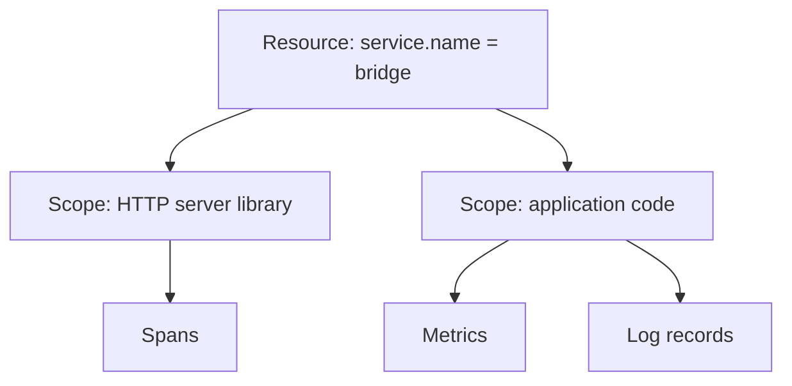

# Resource Identity, Scope And Correlation

Two services in the `starfleet` namespace, `bridge` and `probe`, send telemetry to the same Collector. A reader of the data has to answer two questions for every item: which service produced it, and which items belong together. This part explains the fields that answer both questions.

## Resource: the entity that produces telemetry

A **resource** is the entity that produces telemetry. It is described by **resource attributes**, key-value pairs that are attached once to every item that the entity sends. A resource is usually one service instance, one process or one container.

OpenTelemetry defines names for these attributes in its semantic conventions. The ones that matter most for identity are:

- `service.name`: the logical name of the service, for example `bridge`. A service name is required. A program that does not set it gets the placeholder `unknown_service`, followed by the process name in many SDKs.
- `service.namespace`: a group of services that belong together, for example `starfleet`.
- `service.instance.id`: the unique identity of one running copy of the service.
- `service.version`: the version of the deployed code.
- `deployment.environment.name`: the environment, for example `production` or `staging`.
- Attributes of the platform, such as `k8s.namespace.name`, `k8s.pod.name` and `host.name`.

A resource is not the same thing as a span attribute. A span attribute describes one operation, such as the URL of one request. A resource attribute describes the producer and is the same for every item that producer sends. When a value changes from request to request, it does not belong on the resource.

Resource attributes reach the SDK in two ways. The program sets them with the environment variable `OTEL_RESOURCE_ATTRIBUTES`, with the form `key=value,key2=value2`, and `OTEL_SERVICE_NAME` sets the service name. Resource detectors can also fill in attributes of the host, the container or the cloud provider. A Collector processor can add or change them later, which is useful when the sender cannot be changed.

## Instrumentation scope: the code that recorded the item

The **instrumentation scope** names the library or the code unit that created the telemetry. It has a name and an optional version. A service can run many instrumentation libraries at the same time: one for the HTTP server, one for the database client and one for the application's own code. Each library has its own scope.

The two concepts must stay apart. The resource says which service sent the item. The scope says which code inside that service created it. When the scope name is used as the service name, one service appears as many, and when two services share the same `service.name`, their data is merged into one.

## How a Collector groups the data

OTLP data is nested. A request holds one or more resources. Each resource holds one or more scopes. Each scope holds the items: spans, metric data points or log records.



This is the structure that the `debug` exporter prints. A line that starts with `ResourceSpans` opens a resource. The `Resource attributes:` list follows. Under it, `ScopeSpans` opens a scope with its name. The spans come last.

## Correlation across signals

Three mechanisms let a reader move from one signal to another.

The first is the **shared resource**. Metrics, traces and logs from the same service carry the same `service.name` and the same environment, so a query can place them side by side. A mismatch breaks this: a metric labelled `bridge` and a trace labelled `bridge-service` look like two services.

The second is the **trace context in a log record**. A record written while a span is active carries that span's trace ID and span ID. A reader can then open the log for one slow trace. A record written outside any span has empty identifiers and cannot be joined this way.

The third is the **exemplar** on a metric data point. An exemplar is one sample measurement stored next to an aggregated point. It can carry a trace ID and span ID, so that a reader can jump from a spike in a histogram to one trace that produced it. Support for exemplars depends on the SDK and on the backend, and an aggregated point does not have an exemplar for every contribution.

Between services, the **trace context** travels in request headers. The W3C Trace Context standard defines the header `traceparent`, which carries the trace ID and the ID of the calling span. A receiving service uses it as the parent of its own spans, so both services contribute spans to one trace. If a service in the middle does not forward the header, the trace breaks into two.

## Change the resource in the playground

The playground Collector has three pipelines and no processors. The goal is to add a resource attribute with a Collector processor, and to see which signals receive it.

<!-- astrona:playground:renew -->

First read the current resource of each signal. Print the last 30 seconds of the log:

```sh
kubectl -n observability logs deploy/otel-collector --since=30s --tail=-1
```

Find the `Resource attributes:` line in a `ResourceSpans` block and in a `ResourceMetrics` block. Both name `service.name` and nothing about the environment.

Save this as `collector-config.yaml`. It adds a `resource` processor and puts it into the `traces` pipeline only:

```yaml
apiVersion: v1
kind: ConfigMap
metadata:
  name: otel-collector-config
  namespace: observability
data:
  collector.yaml: |
    receivers:
      otlp:
        protocols:
          grpc:
            endpoint: 0.0.0.0:4317
          http:
            endpoint: 0.0.0.0:4318
    processors:
      resource:
        attributes:
          - key: deployment.environment.name
            value: production
            action: upsert
    exporters:
      debug:
        verbosity: detailed
    service:
      pipelines:
        traces:
          receivers: [otlp]
          processors: [resource]
          exporters: [debug]
        metrics:
          receivers: [otlp]
          processors: []
          exporters: [debug]
        logs:
          receivers: [otlp]
          processors: []
          exporters: [debug]
```

Apply it and restart the Collector, because the Collector reads the file only when it starts:

```sh
kubectl apply -f collector-config.yaml
kubectl -n observability rollout restart deployment/otel-collector
kubectl -n observability rollout status deployment/otel-collector
```

Wait 20 seconds, and read the log of the new pod:

```sh
kubectl -n observability logs deploy/otel-collector --since=20s --tail=-1
```

Check three things:

- A `ResourceSpans` block lists `deployment.environment.name` with the value `production`.
- A `ResourceMetrics` block and a `ResourceLog` block do not list it, because their pipelines have no processor.
- The `service.name` attributes are unchanged. The action `upsert` adds the key when it is missing and replaces the value when it exists. Other keys stay as they are.

Add `resource` to the `metrics` and `logs` pipelines and apply and restart again to make the environment appear on all three signals. A processor takes effect only in the pipelines that list it.

## What to take from this

- Resource attributes name the producer. Span attributes and data point attributes name one operation or one population.
- `service.name` is the grouping key for almost every backend. Two services with the same name are merged, and one service with two names is split.
- A scope names the instrumentation code and is not the service identity.
- A log record is joined to a trace only through its trace ID and span ID, and a metric is joined only through an exemplar when one exists.

## Common pitfalls

> [!WARNING]
> Do not put a value that changes per request, such as a user identifier or an order number, on the resource. It makes every request look like a new producer. Do not assume that a processor applies to all signals: each pipeline lists its own processors, and a processor in the `traces` pipeline leaves metrics and logs untouched.
