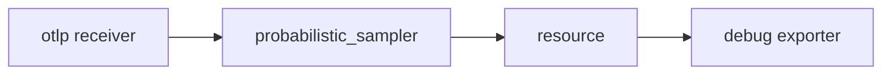

# Collector Pipelines, Sampling And Evidence Limits

The OpenTelemetry Collector sits between the programs that produce telemetry and the systems that store it. What it receives, changes and forwards decides which evidence exists later. This part explains how a Collector is assembled, why a signal without a pipeline disappears, and how sampling, attribute volume and sensitive values limit what the data can prove.

## The parts of a Collector

A Collector is one program that is assembled from components. Each component has one job:

- A **receiver** accepts telemetry. The `otlp` receiver listens for OTLP over gRPC (port 4317 by default) and over HTTP (port 4318 by default).
- A **processor** changes telemetry on its way through, for example by adding an attribute, dropping an item or grouping items into batches.
- An **exporter** sends telemetry out. The `debug` exporter writes items to the Collector's own log. Other exporters send to a backend.
- A **connector** joins two pipelines, and an **extension** adds a capability such as a health check endpoint.

Declaring a component in its own section does not use it. A component runs only when a pipeline names it. The pipelines are listed under `service` and `pipelines`. Each pipeline handles exactly one signal type: `traces`, `metrics` or `logs`. A pipeline lists its receivers, then its processors, then its exporters.

```yaml
service:
  pipelines:
    traces:
      receivers: [otlp]
      processors: [probabilistic_sampler, resource]
      exporters: [debug]
```

The processors run in the order in which they are listed. The first listed processor sees the item first. When a pipeline lists a sampler before a processor that adds attributes, the items that the sampler dropped never reach the second processor.



The diagram shows one traces pipeline. A different pipeline for metrics can reuse the same receiver and exporter with different processors.

## A signal without a pipeline is not processed

The `otlp` receiver can accept traces, metrics and logs, but it passes them on only for the signal types that appear in a pipeline. If the Collector has a `traces` pipeline and no `metrics` pipeline, a metrics request has nowhere to go. The Collector does not process those metrics, and nothing from them reaches an exporter.

The sender sees this differently depending on the protocol and the SDK. It may log an error, it may retry and then drop, or it may not report anything useful. A sender that stays healthy tells you nothing about whether its data arrived. The place to confirm delivery is the end of the path: the exporter output or the backend.

## Sampling

Sampling means keeping only some of the items. It exists because traces and logs can be too large to keep in full.

**Head sampling** decides when a trace starts, before the outcome of the request is known. The `probabilistic_sampler` processor is a head sampler. It reads the trace ID and keeps a configured share. With `sampling_percentage: 25`, about one trace in four is kept. Because the decision comes from the trace ID, every Collector that uses the same setting makes the same decision for the same trace, so a kept trace stays complete.

**Tail sampling** decides after the spans of a trace have been collected, so it can keep every trace that contains an error or is slow. It needs all spans of a trace in one place, which makes it more costly to run.

A sampler changes what a reader can conclude:

- A count of kept spans is lower than the real number of requests. Dividing by the sampling share gives an estimate, not a count.
- A rare event, such as one failed payment in a thousand, can be missing from the kept traces.
- Sampling applies per signal. Sampling traces does not change metrics, and counters stay exact because they are computed before spans are dropped.

For this reason, a sampler belongs in the `traces` pipeline only. Adding it to the `metrics` pipeline would be a mistake, because the sampler processor is not designed for metrics.

## Volume, cardinality and sensitive values

Every attribute on a metric data point multiplies the number of series. A **series** is one unique combination of metric name and attribute values. The attribute `route` with 20 values and the attribute `code` with 6 values give up to 120 series for one metric. An attribute with an unbounded set of values, such as a customer ID, creates a new series for every value. This is **high cardinality**, and it raises the cost of storing and querying metrics until the backend rejects or drops data.

Attributes on spans and logs do not multiply series in the same way. They still cost space and can hold personal or secret data: an email address in a span attribute or a token in a log body. Once the item leaves the program, every component on the path can see the value. A Collector can remove it before export, but the program and the network up to the Collector have already handled it. The safe place to prevent a sensitive value is the instrumentation that creates it.

Other things also limit the evidence: an exporter that fails and drops its queue, a backend that retains data for a limited time, and clocks that differ between machines. State the population, the time window and the collection assumptions with any conclusion drawn from telemetry.

## Change the pipelines in the playground

<!-- astrona:playground:renew -->

First measure the amount of span data without sampling. Count the spans in the last 60 seconds:

```sh
kubectl -n observability logs deploy/otel-collector --since=60s --tail=-1 | grep -c 'Span #'
```

Write the number down. Then save this as `collector-config.yaml`. It removes the `logs` pipeline and samples traces at 10 percent:

```yaml
apiVersion: v1
kind: ConfigMap
metadata:
  name: otel-collector-config
  namespace: observability
data:
  collector.yaml: |
    receivers:
      otlp:
        protocols:
          grpc:
            endpoint: 0.0.0.0:4317
          http:
            endpoint: 0.0.0.0:4318
    processors:
      probabilistic_sampler:
        sampling_percentage: 10
    exporters:
      debug:
        verbosity: detailed
    service:
      pipelines:
        traces:
          receivers: [otlp]
          processors: [probabilistic_sampler]
          exporters: [debug]
        metrics:
          receivers: [otlp]
          processors: []
          exporters: [debug]
```

Apply it and restart the Collector:

```sh
kubectl apply -f collector-config.yaml
kubectl -n observability rollout restart deployment/otel-collector
kubectl -n observability rollout status deployment/otel-collector
```

Wait 60 seconds, then repeat the measurements:

```sh
kubectl -n observability logs deploy/otel-collector --since=60s --tail=-1 | grep -c 'Span #'
kubectl -n observability logs deploy/otel-collector --since=60s --tail=-1 | grep -c 'ResourceLog'
```

Check these points:

- The span count is lower than before. It is not exactly 10 percent of the old number, because the sampler keeps a share of trace IDs and the sample is small.
- The count of `ResourceLog` lines is 0. The `logs` pipeline does not exist, so the Collector processes no logs.
- The generator `bridge-load` still runs. Check with `kubectl -n starfleet get pods`. A healthy sender does not prove that its data arrives.
- Metrics still appear in full. Run `kubectl -n observability logs deploy/otel-collector --since=30s --tail=-1 | grep -c 'ResourceMetrics'` and expect a number above 0.

To restore all signals, add the `logs` pipeline again with `receivers: [otlp]`, `processors: []` and `exporters: [debug]`, then apply the file and restart the Collector.

## What to take from this

- A component is active only when a pipeline lists it, and each pipeline handles one signal.
- A processor runs in the order in which it is listed, and its effect is limited to the pipelines that list it.
- Sampling keeps a share of traces. It makes kept counts lower than the truth and can drop rare events.
- Unbounded attribute values multiply metric series, and sensitive values are best prevented at the source.

## Common pitfalls

> [!WARNING]
> Do not trust a healthy sender as proof of delivery. A signal without a pipeline is not processed, and the sender may report nothing. Do not edit the ConfigMap and expect the running Collector to change: it reads its file at start, so restart the Deployment. Write the pipeline lists in the order `receivers`, `processors`, `exporters`, and keep the sampler in the `traces` pipeline only.
