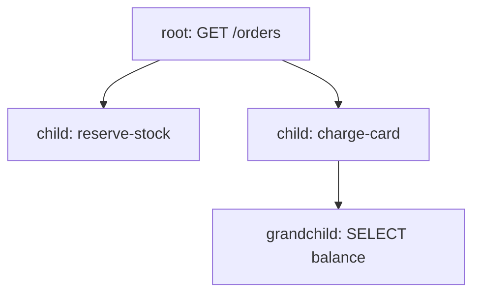

# Span Context And The Parent-Child Structure

A single request to the `shuttle` service can create several spans: one for the incoming request, one for each call it makes and one for each query it runs. Nothing in a span says "I belong to that request" except a few identifiers. This part explains those identifiers, because every later question about a trace, from sampling to correlation with logs, depends on them.

## The span context

The **span context** is the small set of values that identifies a span and travels with it. It has four fields:

- The **trace ID** is 16 bytes, written as 32 hexadecimal characters. Every span of one request shares the same trace ID.
- The **span ID** is 8 bytes, written as 16 hexadecimal characters. It is unique to one span inside the trace.
- The **trace flags** are one byte. The lowest bit is the **sampled** flag, which says that the trace is recorded and exported.
- The **trace state** is an optional list of key-value pairs that vendors can use to pass their own data along the trace.

A span also stores the span ID of its **parent**. A span whose parent span ID is empty is the **root span**. Every other span names exactly one parent, so the spans of a trace form a tree. The OpenTelemetry SDK builds this tree while the program runs. The backend that stores the spans only reads the identifiers.



The diagram shows one trace with four spans. All four carry the same trace ID, and each child carries the span ID of its parent.

## In-process and remote parents

Inside one program, the SDK keeps the **current context** for the running thread or task. When code starts a new span, the SDK takes the span in the current context as the parent. That is how `reserve-stock` becomes a child of `GET /orders` without any code naming the parent.

Across a process boundary there is no shared memory. The caller must send the span context in the request, for example in the HTTP header `traceparent`, and the receiving program must read it. The receiving span then has a **remote parent**: its parent span lives in another process. The rule is the same in both cases, only the transport differs. A trace that spans several services exists only if every hop passes the context on.

## Read the identifiers in the playground

<!-- astrona:playground:renew -->

The generator `shuttle-load` sends traces for the service `shuttle`. One container creates traces with two child spans. Read the log of the Collector:

```sh
kubectl -n observability logs deploy/otel-collector --since=30s --tail=-1 | grep -E 'Trace ID|Parent ID|Name' | head -30
```

The `debug` exporter prints one block per span. The lines labelled `Trace ID` and `Parent ID` hold the identifiers. A root span has an empty value after `Parent ID`. Now count how many spans share each trace ID:

```sh
kubectl -n observability logs deploy/otel-collector --since=30s --tail=-1 | grep 'Trace ID' | awk '{print $NF}' | sort | uniq -c | sort -rn | head -5
```

Each output line has a count and a trace ID. Traces from the `traces-ok` container show a count of 3: one root and two children. Traces from the `traces-error` container and from `probe-load` show a count of 1, because those generators create one span per trace. The count can be lower than the real number when a trace crosses the edge of the 30 second window.

To see all spans of one trace, copy one trace ID from the first column and search for it. Replace `<TRACE_ID>` with the value:

```sh
kubectl -n observability logs deploy/otel-collector --since=60s --tail=-1 | grep -B2 -A12 '<TRACE_ID>'
```

Check that the root span has no parent and that the children name the root span ID as their parent. The `debug` exporter output is not a fixed format and can change between Collector releases, so read the labels in your version.

## Why the identifiers matter

The trace ID is the key that joins everything about one request. A log record that carries the same trace ID belongs to the same request. A tail sampler that groups spans by trace ID keeps or drops the whole trace together. A backend that cannot find the parent span of a span shows that span as an orphan, which is a sign that a hop did not pass the context or that the parent was dropped.

The trace flags matter just as much. When the sampled bit is 0, the SDK may still create spans in memory, but it does not export them. A program that receives a sampled bit of 0 from its caller usually follows that decision, so one early decision applies to every later hop.

This part showed how the identifiers build the tree and where they sit in the output. The next question is what else a span records besides its place in the tree, and how a reader should use the kind, the status, the events and the links.

## Common pitfalls

> [!WARNING]
> Do not read the span ID as a request ID. Only the trace ID is shared by all spans of a request. Do not assume that a trace in the output is complete: the output shows a time window, and spans of one trace can arrive in different windows. A root span with an empty parent is the start of the trace only when every earlier hop propagated its context.
