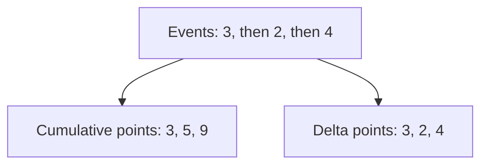

# Metric Instruments, Data Points And Temporality

A metric is a series of data points that share a name, a unit and a set of attributes. The data model fixes what kinds of data point exist, and the way a program reports them over time is called temporality.

## Instruments and the data points they produce

An **instrument** is the object that code uses to record a measurement. Each instrument produces one kind of data point.

| Instrument | Records | Data point kind |
| --- | --- | --- |
| Counter | A value that only increases | Sum, monotonic |
| UpDownCounter | A value that increases and decreases | Sum, not monotonic |
| Histogram | A distribution of values | Histogram or exponential histogram |
| Gauge | The current value at a moment | Gauge |

The asynchronous versions of a counter, an up-down counter and a gauge read their value from a callback when the SDK collects, and not at each event. The data point kinds are **sum**, **gauge**, **histogram** and **exponential histogram**. A summary kind also exists in the data model, but it exists to carry data that comes from other systems, and the SDKs do not produce it.

A sum has a flag that tells if it is **monotonic**. A monotonic sum never decreases except at a reset. A histogram carries a count, a sum, and a list of bucket counts with explicit bounds. An exponential histogram carries buckets whose bounds follow a formula with a scale value, so the SDK does not need a fixed list of bounds.

## Aggregation temporality

A sum and a histogram say how each point relates to the previous one. This is the **aggregation temporality**.

- **Cumulative**: each data point holds the total since a start time. The next point holds a larger total with the same start time.
- **Delta**: each data point holds only the change since the previous point. The start time of a point is the end time of the previous one.



The diagram shows the same three intervals reported in both ways.

A cumulative series survives a lost data point, because the next point still holds the full total. A delta series needs every point, because a lost point is lost for good. A cumulative series needs the sender to keep state for every attribute combination, and a delta series does not. Prometheus stores cumulative values, so a pipeline that ends in Prometheus must deliver cumulative sums. Some backends prefer delta. The Collector contains the processors `cumulativetodelta` and `deltatocumulative` for the conversion.

## Start time and resets

Every cumulative point carries a **start time**. When a process restarts, its counter begins again at 0 with a new start time. A reader that sees the value fall and the start time change knows that the counter was **reset**, and it does not treat the fall as a negative rate. This is why the start time is part of the data point.

## Read data points in the playground

<!-- astrona:playground:renew -->

The playground sends a sum from `telemetrygen` and a gauge named `fuel.level`. Read the Collector output for the metrics pipeline:

```sh
kubectl -n observability logs deploy/otel-collector --since=60s --tail=-1 | grep -E 'Name:|DataType|AggregationTemporality|IsMonotonic|StartTimestamp'
```

Find the metric names and the line `DataType` of each. For the sum, find the line `AggregationTemporality` and the line `IsMonotonic`. Compare two outputs of the sum a few seconds apart: the `StartTimestamp` stays the same and the value changes if the temporality is cumulative.

The data points now have a kind and a temporality that you can name. The next signal is the log record.

## Common pitfalls

> [!WARNING]
> Do not add delta points from two different senders without checking their start times. Do not read a fall in a cumulative value as a negative rate: it is a reset. Do not send delta sums to a backend that expects cumulative values. Do not use an unbounded attribute on an instrument, because every combination is a series.
