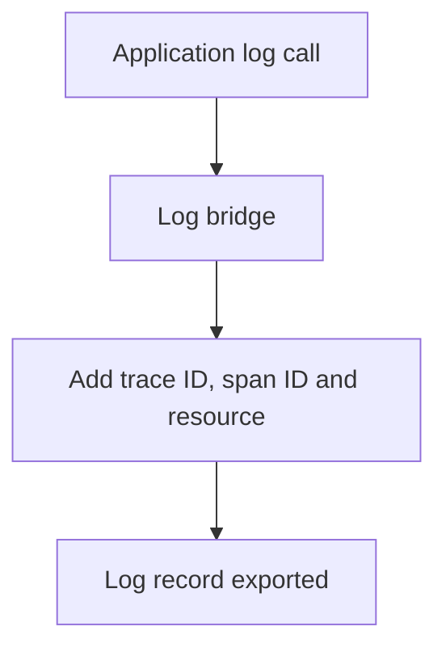

# Log Records, Severity And Correlation

A log record is a timestamped statement from a program. The log data model defines its fields, so that logs from different languages and frameworks can be handled in one pipeline.

## Fields of a log record

| Field | Meaning |
| --- | --- |
| Timestamp | When the event happened, set by the source |
| ObservedTimestamp | When the Collector or the SDK saw the record |
| TraceId and SpanId | The span that was active when the record was written |
| TraceFlags | The same flags as in the span context |
| SeverityText | The level as the source wrote it, such as `Warning` |
| SeverityNumber | A number from 1 to 24 that puts the level on a common scale |
| Body | The message, which can be a string or a structured value |
| Attributes | Key-value pairs about the event |
| Resource and scope | The producer and the instrumenting code, as for other signals |

The timestamp and the observed timestamp are separate because a log file is often read later than it was written. If the source has no timestamp, only the observed timestamp is set.

## The severity scale

The severity number maps every logging library to one scale. The ranges are fixed.

| Numbers | Level |
| --- | --- |
| 1 to 4 | Trace |
| 5 to 8 | Debug |
| 9 to 12 | Info |
| 13 to 16 | Warn |
| 17 to 20 | Error |
| 21 to 24 | Fatal |

The text is for people and the number is for filters. A filter that compares `severity_number` works for all sources, but a filter that compares text must know each spelling, such as `WARN`, `Warning` and `warn`. A record with severity number 0 has no severity set.

## Correlation with traces

When a log record carries a trace ID and a span ID, a backend can show the log lines of one request next to its spans. The SDK adds both fields when the code writes through a **log bridge**: an adapter that connects an existing logging library, such as the logging module of Python, to the OpenTelemetry Logs API. The application does not call the Logs API itself in most cases. A record that is written outside any span has an empty trace ID.



The diagram shows that the correlation fields are added at the bridge, and not written by the application.

## Read log records in the playground

<!-- astrona:playground:renew -->

The playground sends logs at three levels from the service `shuttle`. Read the Collector output:

```sh
kubectl -n observability logs deploy/otel-collector --since=60s --tail=-1 | grep -E 'SeverityText|SeverityNumber|Body|Trace ID'
```

Find the three severity texts and match each text to its number with the table above. The `Trace ID` of these records is empty, because the generator writes them outside any span.

The fields and the scale are now clear. The next part covers events and profiles.

## Common pitfalls

> [!WARNING]
> Do not filter logs by the text of the level: spellings differ between sources. Do not expect a trace ID on a record that was written outside a span. Do not confuse the timestamp with the observed timestamp. Do not log secrets in the body or in attributes, because the Collector forwards them as they are.
