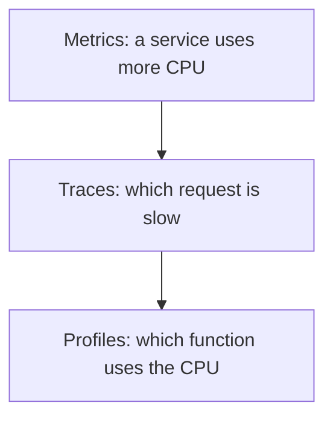

# Events And Profiles

Two more kinds of telemetry need a place in the model: events that describe something that happened, and profiles that describe where a program spends its resources.

## Two meanings of event

The word event is used in two places.

A **span event** is a timestamped note stored inside one span. It has a name and attributes, and it lives and travels with its span. The exception event that records a failure is a span event. If the span is not sampled, its events are gone too.

An **event as a log record** is a log record that carries an event name. The semantic conventions give such events a name and a set of attributes, in the same way as for spans. The record is exported as a log and does not depend on a span. When a span is active, the record carries the trace ID and the span ID, so it is still correlated.

| Question | Span event | Log record event |
| --- | --- | --- |
| Where is it stored? | Inside the span | As its own record |
| Does sampling of the trace remove it? | Yes | No, unless the logs are filtered |
| Needs an active span? | Yes | No |

Choose a span event for a note that only makes sense inside one operation. Choose a log record event for something that must be kept whether or not a trace exists, such as a user login or a deployment.

## Profiles

A **profile** records where a program spends a resource, usually processor time or memory, by sampling the call stack many times per second. Each sample is a stack of function frames with a value. The data shows which functions use the most time.



The diagram shows that profiles answer the question that metrics and traces leave open, which is the line of code.

Profiles are the fourth signal in OpenTelemetry. The data model builds on the idea of the pprof format and adds links to traces, so that a profile sample can point to the span that was running. At the time of writing, the profiles signal is still in development, and its interfaces and the Collector support can change between releases. Check the status of the signal in the specification before you depend on it.

## Compare in the playground

<!-- astrona:playground:renew -->

The Collector prints a span event under the span and a log record in the logs section. Read both from the same output:

```sh
kubectl -n observability logs deploy/otel-collector --since=60s --tail=-1 | grep -E 'Span #|Events|LogRecord #'
```

Count the log records and the spans. The log records have their own entries, and no span lists them. A span event, if one exists, is printed below its span as an `Events` section.

The difference between where the data lives is now visible. The last part puts the signals side by side.

## Common pitfalls

> [!WARNING]
> Do not rely on a span event for something that must survive trace sampling. Do not log an event without a name, because a name is how a backend groups events. Do not plan an operations process on the profiles signal before you check its status. Do not assume that a profile and a trace are linked unless the SDK adds the link.
