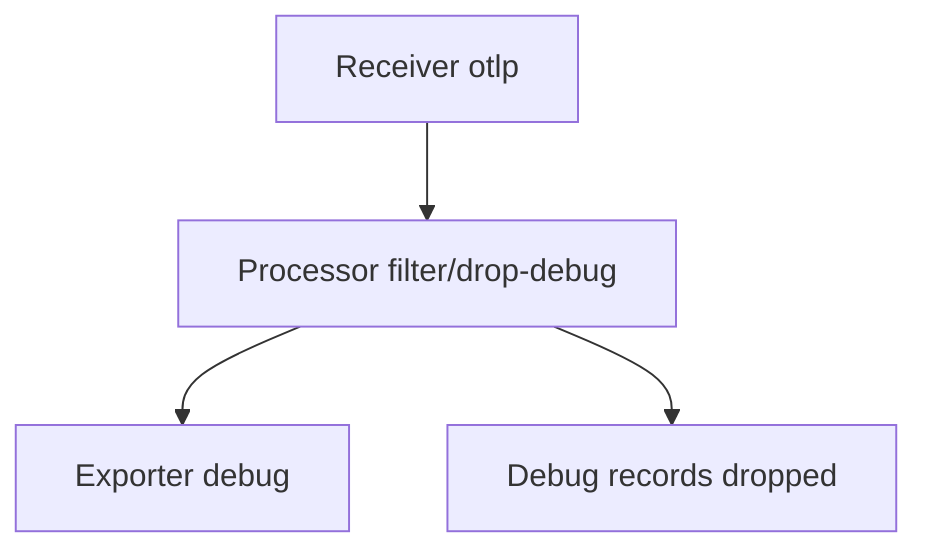

# Choosing A Signal And Filtering Logs In The Collector

A team has more questions than it can afford to answer with every signal. This part gives a way to choose, and shows how to cut the cost of logs with a processor.

## Which signal answers which question

| Question | Best signal | Why |
| --- | --- | --- |
| How many orders per minute in the last week? | Metric | A small aggregate that is cheap to store |
| Which step of this request was slow? | Trace | The spans give timing and structure |
| What did the program say at 10:03? | Log | A free-form record of an event |
| Which function uses the processor time? | Profile | Stack samples show the code |

Start from the question. Metrics tell that something changed, traces tell where, logs tell what the program reported, and profiles tell which code. A dashboard and an alert normally read metrics, because metrics are small and fast to query.

## The cost of volume

Debug logs are the largest source of waste. A program that writes thousands of debug lines per second creates storage cost and hides the lines that matter. Filtering at the source needs a new release. Filtering in the Collector needs only a configuration change, and it applies to every program that sends to the Collector.

## The filter processor

The `filter` processor drops items for which a condition is true. The conditions are written in the OpenTelemetry Transformation Language (OTTL). For logs, the condition sits under `logs` and `log_record`:

```yaml
processors:
  filter/drop-debug:
    error_mode: ignore
    logs:
      log_record:
        - severity_number < SEVERITY_NUMBER_INFO
```

The condition drops every record with a severity number below 9, which means trace and debug records. The constant `SEVERITY_NUMBER_INFO` is the value 9. The field `error_mode: ignore` tells the processor to continue when a condition fails on a record, and to log the error. The name after the slash, `drop-debug`, is an instance name: it allows several filters of the same type.

The processor does nothing until a pipeline lists it. The list is ordered, and the items go through the processors in that order:

```yaml
service:
  pipelines:
    logs:
      receivers: [otlp]
      processors: [filter/drop-debug]
      exporters: [debug]
```



The diagram shows that a dropped record never reaches the exporter.

A record that was dropped is gone. The backend cannot show it later, so filter only what is safe to lose, and keep the filter in one place that the team can read.

## Filter the logs in the playground

<!-- astrona:playground:renew -->

Read the severity texts that arrive now:

```sh
kubectl -n observability logs deploy/otel-collector --since=60s --tail=-1 | grep 'SeverityText' | sort | uniq -c
```

Three texts appear: Info, Debug and Error. Print the Collector configuration:

```sh
kubectl -n observability get configmap otel-collector-config -o jsonpath='{.data.collector\.yaml}'
```

Add the `filter/drop-debug` processor above, list it in the `logs` pipeline only, apply the ConfigMap and restart the Collector:

```sh
kubectl -n observability rollout restart deployment/otel-collector
```

After about 30 seconds, run the `sort | uniq -c` command again with `--since=20s`. The text Debug is gone, and Info and Error remain. The metrics and traces pipelines are unchanged.

The Collector now drops debug records before export. The lab repeats this change in a cluster that starts without the filter.

## Common pitfalls

> [!WARNING]
> Do not put the filter in a pipeline that carries signals you want to keep whole: a processor listed in a pipeline applies only to that pipeline. Do not forget to restart the Collector after a ConfigMap change, because the file is read at start. Do not drop records you may need for an audit. Do not compare the text of the severity when the number is available.
