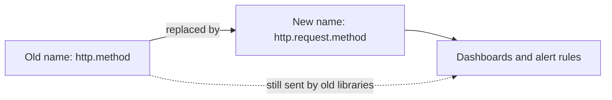

# Semantic Conventions As A Shared Contract

A service named `scout` in the `starfleet` namespace sends spans for its web requests. Its team stored the request method under the attribute `http.method`. Another team that runs a dashboard looks for `http.request.method`. Both teams are right about their own data, and the dashboard shows nothing. This part explains the agreement that is meant to prevent this, and what the agreement does and does not guarantee.

## What a semantic convention is

A **semantic convention** is a published definition of the names, types, meanings and allowed values of telemetry fields. OpenTelemetry maintains these conventions for many areas: HTTP, databases, messaging, remote procedure calls, Kubernetes, cloud providers, the process and the host. They are organized as a registry of attributes plus a set of documents that say which attributes a span, a metric or a log record of a given kind should carry.

A convention covers more than the spelling of a name:

- The **name**: lowercase words separated by dots to show a namespace, and underscores inside a word. `http.request.method` belongs to the `http` namespace.
- The **type**: a string, an integer, a floating-point number, a boolean, or an array of one of these. The attribute `http.response.status_code` is an integer.
- The **meaning**: what the value describes and in which situation it is set.
- The **allowed values**: for example, `http.request.method` holds a known method name such as `GET` or `POST`, and `_OTHER` for a method that is not known.
- The **unit**, for metrics: the convention for HTTP server duration is `s`, seconds, not milliseconds.

The reason for this level of detail is that backends, dashboards and alert rules are written against names and types. A query that filters on `http.response.status_code >= 500` works only if the value is an integer and has that name.

## Requirement levels

A convention does not demand every attribute on every item. It assigns each attribute a **requirement level**:

- **Required**: the instrumentation must set it.
- **Conditionally required**: it must be set when a stated condition is true, for example when an error occurred.
- **Recommended**: it should be set unless the cost or a privacy concern argues against it.
- **Opt-in**: it is set only when the user turns it on, usually because it is large or sensitive.

An attribute that is recommended but missing is not an error. A reader still cannot assume it is present, so a query that depends on a recommended attribute has to handle its absence.

## Stability and deprecation

Conventions change over time. Each attribute and each convention document carries a **stability level**. A *stable* convention is covered by a compatibility promise: it is not renamed or removed in a way that breaks existing users. A convention in *development* can still change. A name that is replaced is marked **deprecated**, and the new name is listed as its replacement.

The HTTP conventions are the best known example. Older instrumentation used `http.method`, `http.status_code`, `http.url` and `http.scheme`. The stable conventions use `http.request.method`, `http.response.status_code`, `url.full` and `url.scheme`. Another rename moved the environment attribute from `deployment.environment` to `deployment.environment.name`. Instrumentation libraries are updated at different times, so telemetry from one system can carry old names while telemetry from another carries new names.

Some instrumentation supports a transition period. The environment variable `OTEL_SEMCONV_STABILITY_OPT_IN` tells it which version of the conventions to emit. A value such as `http` selects the new names, and `http/dup` emits both the old and the new names so that consumers can move step by step. When the old names are removed, a consumer that never moved stops matching.



The diagram shows why a mixed fleet breaks consumers: the same fact arrives under two names.

## Units and value types

A convention also fixes how a value is written, because two correct numbers in different units cannot be compared. Durations in the stable HTTP metric conventions are in seconds, so a request of 250 milliseconds is recorded as `0.25`. Unit names follow the Unified Code for Units of Measure, which writes `s` for seconds and `By` for bytes. A metric that is recorded in milliseconds under a name that the convention defines in seconds is wrong by a factor of 1000, and nothing in the data marks the mistake.

Attribute values are typed in OTLP. A value is a string, an integer, a double, a boolean or an array. The type survives the trip through a Collector, so a processor that copies an attribute copies its type as well. A backend can store the same name with two types as two different fields, and a query written for one type does not match the other.

## Custom attributes

A program needs attributes that no convention defines, for example the number of items in an order. The rule is to use a name that cannot collide with a future convention. The OpenTelemetry guidance is to prefix the name with a namespace that you own, for example `starfleet.order.items`, and never to start a custom name with `otel.`. A custom name should not reuse a standard name with a different meaning, because the standard name would then lie to every tool that knows it.

## Look at attributes in the playground

The playground has a Collector with one traces pipeline and no processors, and the generator `scout-load`. The generator sends spans for the service `scout` with the attributes `http.method`, `http.status_code` and `user.email`.

<!-- astrona:playground:renew -->

Print the last 30 seconds of the Collector log:

```sh
kubectl -n observability logs deploy/otel-collector --since=30s --tail=-1
```

Find one span. Under its `Attributes:` heading you see lines that start with `->`. Each line shows the attribute name and the value with its type in parentheses. A string value appears as `Str(...)` and an integer as `Int(...)`.

Answer these questions from the output:

- What is the type of `http.status_code`? Explain why a consumer that expects a string and compares the value with the text `"200"` does not match.
- Which of the three attributes has a standard name in the stable conventions, and which does not? Look at the stable names listed above to decide.
- Is `user.email` a convention attribute? Decide whether it should be sent at all.

Check how the sender sets its resource. Find the line `-> service.name: Str(scout)` under `Resource attributes:`. The service name sits on the resource and not on the span.

To see the contract from the other side, write down the names that a dashboard for HTTP latency would need: `http.request.method`, `http.response.status_code` and `http.route`. Compare them with the three attributes that `scout-load` sends. Only a rename can connect the two sets, and a Collector processor can do that rename without a change to the program.

## What to take from this

- A semantic convention fixes the name, type, meaning, allowed values and unit of a field so that independent tools can agree.
- A requirement level states how strongly an attribute is expected, and a recommended attribute can still be missing.
- A stable convention is protected from breaking changes, while a deprecated name still appears in old instrumentation.
- A custom attribute needs its own namespace, and it must not reuse a standard name for another meaning.

## Common pitfalls

> [!WARNING]
> Do not assume that all telemetry in one system uses the same convention version. Libraries are updated at different times, so old and new names can arrive together. Do not change the type of a standard attribute: sending the status code as a string breaks every numeric comparison. Do not invent a custom attribute that starts with `otel.`, because that prefix belongs to OpenTelemetry.
