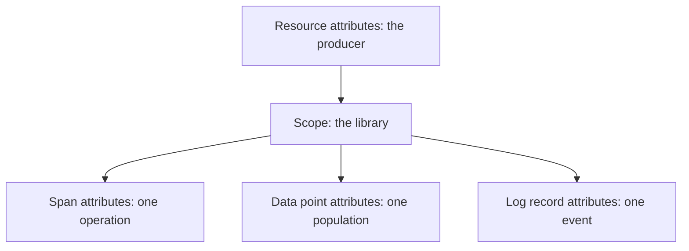

# Resource Attributes And Operation Attributes

Every attribute has a place where it belongs. A value that is placed on the wrong level is repeated millions of times, cannot be grouped, or describes the wrong thing. This part explains the levels on which attributes live, the rule for choosing between them, and the effect of the choice on cost and on queries.

## Where attributes can live

OTLP carries attributes on several levels. The level decides what the attribute describes.

- **Resource attributes** describe the entity that produces the telemetry. They are stored once per resource and apply to every span, data point and log record under it. Examples: `service.name`, `service.version`, `deployment.environment.name`, `k8s.pod.name`.
- **Scope attributes** describe the instrumentation library. They are rare.
- **Span attributes** describe one operation. Examples: `http.request.method`, `http.response.status_code`, `url.path`.
- **Data point attributes** on a metric describe the population that one value summarizes. Examples: `http.route`, `http.response.status_code`.
- **Log record attributes** describe one event.
- **Event and link attributes** describe a timestamped note inside a span or a reference to another span.



The diagram shows that a resource attribute is inherited by every item below it, while the other levels belong to one item.

## The rule for choosing the level

Ask one question: does this value stay the same for every item the producer sends?

- If yes, and it describes the producer, it belongs on the resource. The service name, the version of the deployed code, the environment and the cluster name all pass this test.
- If it changes with the operation, it belongs on the item. The HTTP method, the status code, the URL path and the user all fail the test.

Putting a per-request value on the resource has a high cost. The resource would stop being one stable identity: a backend that groups by resource would create a new group for every request. Putting a producer value on every span has a smaller cost: it works, but it repeats the value in every item and makes the data larger.

The same rule applies in a Collector. A processor named `resource` changes resource attributes, and a processor named `attributes` changes the attributes of the items. Using the wrong one for a value puts it on the wrong level and does not report an error.

## Names that stay small

An attribute value is part of how items are grouped and queried, so the number of different values matters.

The span name should describe a class of operation, not one instance. `GET /orders` is a good name. `GET /orders/10442` is a poor name, because every order creates a new name and a backend that lists span names grows without a limit. The HTTP conventions solve this with two attributes: `http.route` holds the template of the path, such as `/orders/{id}`, and `url.path` holds the actual path, such as `/orders/10442`. A metric uses `http.route` as an attribute, because a data point attribute with unbounded values creates a series for each value.

The rule for metrics is strict. Use only attributes with a small, known set of values. Unbounded values such as user identifiers, session identifiers, request identifiers and full URLs belong on spans or logs, where they are searched for rather than aggregated.

## Errors and status

Spans carry a **status**: unset, ok or error. The convention for errors adds the attribute `error.type`, which holds a low-cardinality class of the failure, such as an exception class name or a status code string. Do not place the free-text message of an exception in `error.type`. A message that contains values such as order numbers is high cardinality. The message belongs in the span event that records the exception, or in a log record.

For an HTTP server span, the status follows the response: a status code of 500 or above sets the span status to error. A status code of 404 does not set an error on a server span, because the server handled the request correctly. This is why a count of error spans and a count of 4xx responses can differ.

## Schema URL

A resource and a scope can carry a **schema URL**. It names the version of the semantic conventions that the producer used. A consumer reads it to learn whether attribute names follow an older or a newer version, and a Collector processor can use the information to transform names between versions. A missing schema URL says nothing about the version, so the attribute names have to be checked by reading them.

## Place attributes in the playground

<!-- astrona:playground:renew -->

The playground has a Collector with one traces pipeline and the generator `scout-load`. Read a span first:

```sh
kubectl -n observability logs deploy/otel-collector --since=30s --tail=-1
```

Sort the four attributes you find, `service.name`, `http.method`, `http.status_code` and `user.email`, with the rule above. Decide for each whether it describes the producer or the operation. Only `service.name` describes the producer, and it is already on the resource.

Now add a resource attribute with a processor. Save this as `collector-config.yaml`:

```yaml
apiVersion: v1
kind: ConfigMap
metadata:
  name: otel-collector-config
  namespace: observability
data:
  collector.yaml: |
    receivers:
      otlp:
        protocols:
          grpc:
            endpoint: 0.0.0.0:4317
          http:
            endpoint: 0.0.0.0:4318
    processors:
      resource:
        attributes:
          - key: deployment.environment.name
            value: production
            action: upsert
    exporters:
      debug:
        verbosity: detailed
    service:
      pipelines:
        traces:
          receivers: [otlp]
          processors: [resource]
          exporters: [debug]
```

Apply it and restart the Collector:

```sh
kubectl apply -f collector-config.yaml
kubectl -n observability rollout restart deployment/otel-collector
kubectl -n observability rollout status deployment/otel-collector
```

Wait 20 seconds and read the log of the new pod:

```sh
kubectl -n observability logs deploy/otel-collector --since=20s --tail=-1
```

Check that `deployment.environment.name` appears under `Resource attributes:` and not in the attribute list of the span. The value was added once, on the resource, and every span of the resource inherits it.

Next change the processor to the `attributes` processor with the same key and value, and use it in the pipeline in place of `resource`. Apply, restart and read the log again. The attribute now appears on each span and not on the resource. The data is the same and the level is different, which changes how a backend can group it.

```yaml
    processors:
      attributes:
        actions:
          - key: deployment.environment.name
            value: production
            action: upsert
```

Return to the `resource` processor when you are done, because the environment is a property of the producer.

## What to take from this

- A resource attribute is stored once and describes the producer. Span, data point and log record attributes describe one item.
- A value that changes per operation does not belong on the resource.
- Metric attributes must have a small, known set of values. Unbounded values belong on spans and logs.
- The `resource` and `attributes` processors act on different levels, so the choice of processor is also the choice of level.

## Common pitfalls

> [!WARNING]
> Do not put identifiers that are different for every request into a metric attribute or into a span name. The number of series and names grows without a limit. Do not write a free-text exception message into `error.type`. Do not assume that the `resource` processor and the `attributes` processor are interchangeable: they write to different levels, and a consumer that filters on the resource will not find a value that was written on the span.
