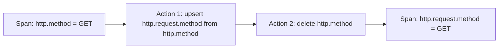

# Normalizing Attributes In The Collector

Producers send what their instrumentation was written to send. A Collector can change that data before it is exported. This part explains the `attributes` processor, which renames, copies, adds and removes attributes, and the rules that decide the result. It also explains what a change in the Collector fixes and what it cannot fix.

## Why normalize in a Collector

A team that runs the dashboards cannot always change the programs that send telemetry. Some programs run old instrumentation that uses `http.method` and `http.status_code`. Some carry an attribute that should never leave the building, such as `user.email`. A Collector is the first component that the team controls on the path, so it is a natural place to fix names and to remove values. The change applies to every producer that sends through it.

A Collector change is a repair at the edge and not a replacement for correct instrumentation. The program still creates the old name, and every component between the program and the Collector still sees it. Fixing the program is the lasting solution, and the Collector rule covers the period until then.

## The attributes processor

The `attributes` processor changes the attributes of spans, log records and metric data points. It does not change resource attributes, because the `resource` processor does that. A processor definition holds a list named `actions`. Each action has a `key` and an `action`.

The actions are:

- `insert`: add the key only when it does not exist.
- `update`: replace the value only when the key exists.
- `upsert`: add the key when it does not exist and replace the value when it does.
- `delete`: remove the key.
- `hash`: replace the value with a hash of the value.
- `extract`: use a regular expression with named groups to pull parts of a value into new keys.
- `convert`: change the type of the value, for example from a string to an integer.

The value for the action comes from a literal `value`, or from another attribute through `from_attribute`. A `from_attribute` copy carries the value together with its type. An integer stays an integer.

```yaml
processors:
  attributes/normalize:
    actions:
      - key: http.request.method
        from_attribute: http.method
        action: upsert
      - key: http.method
        action: delete
```

The processor name after the slash, `normalize`, is a free instance name. A Collector can hold several instances of one processor type under different names.

## The actions run in the listed order

The actions of one processor run from the first to the last. This order decides the result. In the example above, the first action copies `http.method` into `http.request.method`, and the second removes `http.method`. Each fact then has one name.

Reverse the two actions. The first removes `http.method`. The second then looks for `http.method` as its source and does not find it. A copy whose source is missing does nothing, so `http.request.method` is never created. The result is worse than the original data, because the method is gone from the span, and the processor does not report an error.

The order of processors in a pipeline has the same effect. A processor that removes an attribute must come after any processor that needs the value, and before the exporter that sends it.



The diagram shows the correct order. The old key is removed only after the new key holds its value.

## Hashing, removing and what leaves the Collector

For a value that must not be exported, `delete` removes it completely. The `hash` action keeps a stable stand-in: the same input gives the same hash, so two items can still be compared for equality. A hash of a value with few possible inputs, such as a short numeric identifier or an email address in a known domain, can be found again by trying all candidates. Use `hash` for identifiers that are long and random, and `delete` for anything that must not be recoverable.

Two limits apply. A processor in a Collector runs after the Collector received the item, so the value has already travelled from the program to the Collector. Network paths that are not encrypted, and every log of a component before the Collector, may have seen it. The second limit is that deletion works only on the key it is told. A value that appears under another key, or inside a log body, is not removed.

For metrics, a similar rule applies to cost. A data point attribute with a value per customer creates one series per customer. Removing such an attribute from the data points in the Collector reduces the series count, but metrics that differ only in the removed attribute are merged by the backend into one, and the totals can change.

## Apply the processor in the playground

<!-- astrona:playground:renew -->

The playground sends spans for `scout` with `http.method`, `http.status_code` and `user.email`. Save this as `collector-config.yaml`. It copies both old names to the new names, removes the old names and removes the email:

```yaml
apiVersion: v1
kind: ConfigMap
metadata:
  name: otel-collector-config
  namespace: observability
data:
  collector.yaml: |
    receivers:
      otlp:
        protocols:
          grpc:
            endpoint: 0.0.0.0:4317
          http:
            endpoint: 0.0.0.0:4318
    processors:
      attributes/normalize:
        actions:
          - key: http.request.method
            from_attribute: http.method
            action: upsert
          - key: http.method
            action: delete
          - key: http.response.status_code
            from_attribute: http.status_code
            action: upsert
          - key: http.status_code
            action: delete
          - key: user.email
            action: delete
    exporters:
      debug:
        verbosity: detailed
    service:
      pipelines:
        traces:
          receivers: [otlp]
          processors: [attributes/normalize]
          exporters: [debug]
```

Apply it and restart the Collector:

```sh
kubectl apply -f collector-config.yaml
kubectl -n observability rollout restart deployment/otel-collector
kubectl -n observability rollout status deployment/otel-collector
```

Wait 20 seconds and read the log of the new pod:

```sh
kubectl -n observability logs deploy/otel-collector --since=20s --tail=-1
```

Check the attributes of a span:

- `http.request.method` is a string with the value `GET`.
- `http.response.status_code` is an integer with the value `200`, shown as `Int(200)`.
- `http.method`, `http.status_code` and `user.email` do not appear.
- `service.name` under `Resource attributes:` is still `scout`, because the `attributes` processor does not touch the resource.

Now test the order rule. Edit the file so that the two `delete` actions for the old names come before the two `upsert` actions, then apply and restart again. Read the log. The new names do not appear and the old names are gone. Restore the correct order before you continue.

## What to take from this

- The `attributes` processor changes span, log record and data point attributes. The `resource` processor changes the resource.
- Actions run in the listed order, and a copy from a missing key does nothing.
- A `from_attribute` copy keeps the type of the value.
- A Collector rule repairs data at the edge. It does not stop earlier components from handling the value.

## Common pitfalls

> [!WARNING]
> Do not delete the old key before you copy it: the new key is never created and no error is reported. Do not use `hash` as a way to make an email or a short number anonymous, because such values can be guessed. Do not assume that removing an attribute in the Collector keeps the value away from the program logs, the network and any component that comes before the Collector.
