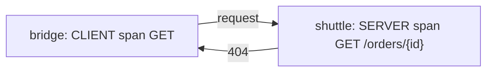

# HTTP And RPC Conventions

HTTP is the protocol that most services use to call each other, so its convention is the one that most dashboards depend on. This part lists the attributes, span names, status rules and metrics that the HTTP convention fixes, and then shows how remote procedure call (RPC) conventions differ.

## HTTP span attributes

The stable HTTP convention uses these main attributes:

- `http.request.method`: the method, for example `GET`. A method that is not known is recorded as `_OTHER`.
- `http.response.status_code`: the response code as an integer, for example `200`.
- `http.route`: the route template that matched on the server, for example `/orders/{id}`. It has low cardinality.
- `url.path`, `url.query` and `url.scheme`: parts of the URL on the server. `url.full` holds the whole URL on a client.
- `server.address` and `server.port`: on a client span, the address of the server being called. On a server span, the name the server was reached by.
- `client.address`: on a server span, the address of the caller.
- `network.protocol.version`: for example `1.1` or `2`.
- `error.type`: set when the operation ended in an error. It holds the status code as text, such as `500`, or the type of the exception.

Older instrumentation used `http.method`, `http.status_code`, `http.url`, `http.target` and `http.host`. The new names replace them. A library that follows the stable convention emits only the new names. Some libraries can emit both during a migration, and the environment variable `OTEL_SEMCONV_STABILITY_OPT_IN` controls that choice.

## Span name, kind and status for HTTP

A server span has the kind `SERVER` and the name `{method} {http.route}`, for example `GET /orders/{id}`. When the route is unknown, the name is only the method. A client span has the kind `CLIENT` and a name made of the method, because the client does not know the route template of the server.

The status follows the side of the call. A server span is set to `ERROR` for a response code of 500 or more, and a 404 stays `UNSET`, because the server did its job. A client span is set to `ERROR` for a code of 400 or more, because the caller did not get what it asked for.



The diagram shows one call. The same 404 is an error on the client span and not an error on the server span.

## HTTP metrics

The HTTP convention defines metrics with fixed names and units:

- `http.server.request.duration`: a histogram of the duration of server requests, in seconds.
- `http.client.request.duration`: the same for client requests.
- `http.server.active_requests`: an up-down counter of requests in progress.
- `http.server.request.body.size` and `http.server.response.body.size`: histograms in bytes.

Their attributes are a small set: `http.request.method`, `http.response.status_code`, `http.route` and `network.protocol.version`, among a few others. The attribute list is short on purpose. `url.path` and `client.address` are not on metrics, because their values are unbounded and would create too many series.

## RPC conventions

The RPC convention covers gRPC and similar protocols. A span has `rpc.system` (for example `grpc`), `rpc.service` (the service name), `rpc.method` (the method name) and, for gRPC, the status code of the call. The span name is `{rpc.service}/{rpc.method}`. These conventions are still marked as development, so check the stability level of the version of the library that you use.

## Compare names in the playground

<!-- astrona:playground:renew -->

The generator `scout-load` sends the old names `http.method` and `http.status_code`. Count the old and new names in the last 30 seconds:

```sh
kubectl -n observability logs deploy/otel-collector --since=30s --tail=-1 | grep -c -E '^ +-> http\.(method|status_code):'
kubectl -n observability logs deploy/otel-collector --since=30s --tail=-1 | grep -c -E '^ +-> http\.(request\.method|response\.status_code):'
```

The first number is above 0 and the second is 0, because the generator uses the old names. A dashboard built on the current convention shows no data for `scout` until the names are changed.

Decide where a Collector change helps and where it does not. A processor can copy a value to the new name. It cannot recreate an attribute that the program never recorded, such as `http.route`.

## What to take from this

The HTTP convention fixes the attribute names, the span name, the kind, the status rule and the metric names and units. Server and client sides use the same attributes with different status rules. Metrics keep their attributes to a small bounded set. RPC follows the same idea with its own names. The next part turns to databases and messaging, where the span name and the sensitive data need extra care.

## Common pitfalls

> [!WARNING]
> Do not use the full path as a metric attribute, because every path creates a new series. Do not mark a 404 on a server span as an error. Do not mix old and new HTTP names in one dashboard query without checking which library version sends which.
