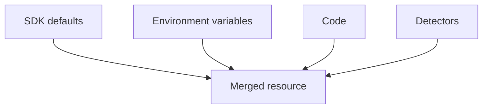

# Where Resource Attributes Come From

Every span, metric data point and log record belongs to a resource. The resource is built once, when the SDK starts, from several sources. Knowing the sources explains why the same service can show different attributes in different environments.

## Sources in an SDK

1. **Defaults.** The SDK sets `telemetry.sdk.name`, `telemetry.sdk.language` and `telemetry.sdk.version`. If no service name is set, it sets `service.name` to `unknown_service`, and many SDKs append the process name.
2. **Environment variables.** `OTEL_SERVICE_NAME` sets the service name. `OTEL_RESOURCE_ATTRIBUTES` is a comma-separated list of `key=value` pairs. If both set the service name, `OTEL_SERVICE_NAME` wins.
3. **Code.** The program can build a resource and pass it to the SDK.
4. **Detectors.** A resource detector reads the environment and adds attributes such as the host name, the operating system, the process, the container ID or the cloud region.

The sources are merged. When two sources set the same key, the later or higher-priority source wins, and a detector must not hide a value that the operator set on purpose.

## Identity attributes

`service.name` is the logical name of the service. `service.namespace` groups services that belong together. `service.version` is the version of the code. `service.instance.id` identifies one running instance, and it must be unique for each instance of the same service name and namespace. A pod name is a common source for the instance ID, and the same service run in 10 pods has 10 instance IDs and one service name.

`deployment.environment.name` names the environment, such as `staging`. It describes where the deployment lives, and it is set by the operator, because no detector can know the intent of the team.



The diagram shows that the resource is the merge of four sources.

## What belongs where

An attribute that is true for the whole process and does not change belongs on the resource. An attribute that changes per request belongs on the item. If a per-request value is put on the resource, the program has to create a new resource for each value, and the SDK does not support that.

## See resource attributes in the playground

<!-- astrona:playground:renew -->

The generator sends traces for the service `shuttle`. Read the resource block of one item:

```sh
kubectl -n observability logs deploy/otel-collector --since=30s --tail=-1 | grep -A8 'Resource attributes' | head -20
```

Find `service.name`. Only the attributes that the generator sets are present, and no host or environment attribute exists yet. The next part adds them in the Collector.

## Common pitfalls

> [!WARNING]
> Do not leave `service.name` unset: backends then group the data under `unknown_service`. Do not give two instances the same `service.instance.id`. Do not store request values on the resource. Do not hide a value that the operator set by a detector that overrides it.
