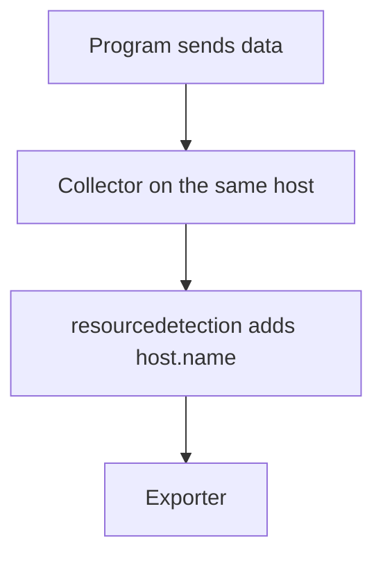

# Resource Detectors In The SDK And The Collector

A **resource detector** is code that reads facts about the place where the program runs and returns them as resource attributes. Detectors exist in the SDKs and in the Collector.

## Detectors in the Collector

The `resourcedetection` processor runs detectors in the Collector and adds the result to every item that passes. It is useful when the Collector runs on the same host or in the same cluster as the program. Some detectors:

| Detector | Attributes it can add |
| --- | --- |
| `env` | Everything in the variable `OTEL_RESOURCE_ATTRIBUTES` of the Collector process |
| `system` | `host.name` and `os.type`, and optional host details |
| `docker` | The host name from the container engine |
| `k8snode` | Kubernetes node information |
| `ec2`, `gcp`, `azure` | Cloud account, region, and instance information |

The detectors run in the order of the list. The configuration:

```yaml
processors:
  resourcedetection:
    detectors: [env, system]
    override: false
    system:
      hostname_sources: ["os"]
```

The setting `override` decides what happens when the item already has a key that a detector returns. With `override: false` the existing value stays, and the detector fills in only what is missing. With `override: true` the detector replaces the existing value. For attributes that come from the program, such as the service name, `false` protects the value the program sent. The setting `hostname_sources` tells the `system` detector where to read the host name; `os` reads it from the operating system.

## Where the Collector detects what

The Collector reads the facts of its own host, not the host of the program that sent the data. If a Collector runs as a central service, the `system` detector returns the host of the Collector, which is wrong for the data of other hosts. In this case use detectors in the SDK, or run the Collector as an agent on each host.



The diagram shows the agent layout, where the detected host is correct.

## Environment detector

The `env` detector reads `OTEL_RESOURCE_ATTRIBUTES` from the environment of the Collector. This gives an operator one place to set the environment name for everything that passes: `deployment.environment.name=staging`. The variable is set on the Collector container.

## Detect in the playground

<!-- astrona:playground:renew -->

The Collector Deployment has `OTEL_RESOURCE_ATTRIBUTES` set to `deployment.environment.name=playground`. No processor uses it yet. Print the variable and the configuration:

```sh
kubectl -n observability get deployment otel-collector -o jsonpath='{.spec.template.spec.containers[0].env}'
kubectl -n observability get configmap otel-collector-config -o jsonpath='{.data.collector\.yaml}'
```

Add the `resourcedetection` processor from above to the `traces` pipeline, apply the ConfigMap and restart the Collector. After 30 seconds read the resource block again, and find `host.name`, `os.type` and `deployment.environment.name`. The value of `service.name` is still `shuttle`.

The three new attributes were added by the Collector. The next part is about the version of the names that the attributes use.

## Common pitfalls

> [!WARNING]
> Do not run the `system` detector in a central Collector and expect the host of the sender. Do not leave `override` at its default when the program sets the same keys. Do not forget that the order of the detector list matters. Remember to restart the Collector after a ConfigMap change.
