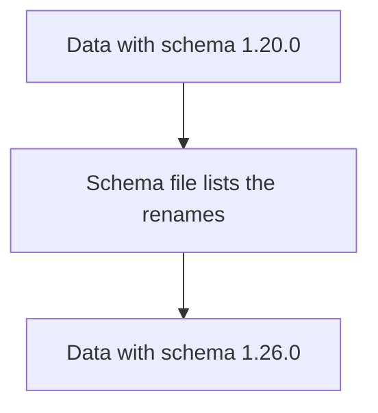

# Schema URLs And Schema Translation

Semantic conventions change over time. An attribute can be renamed or a value can change. A reader of old data needs to know which version of the names the data uses. The **schema URL** carries this information.

## The schema URL

A schema URL is a string that points to a version of the semantic conventions, for example `https://opentelemetry.io/schemas/1.26.0`. The OTLP data carries a schema URL in two places: on the resource and on the scope of the instrumenting library. A producer sets the URL of the conventions version it uses.

| Where | Says |
| --- | --- |
| Resource schema URL | The version of the names used by the resource attributes |
| Scope schema URL | The version of the names used by the library for its spans, metrics and logs |

The two can differ, because the SDK and an instrumentation library are released separately. An empty schema URL means that no version is declared.

## The schema file

The URL points to a file in YAML. The file lists the versions of the conventions in order, and for each version the changes that happened. A change is a transformation such as renaming an attribute from the old name to the new name. A tool that reads the file can transform data from one version to another, for example from `http.method` to `http.request.method`.



The diagram shows that the schema file is the map between two versions.

## Who translates

The schema URL does not translate anything by itself. It only states the version. A translation needs a processor or a backend that reads the schema file. The Collector contrib distribution has a `schema` processor for this purpose; its stability is lower than that of the core processors, so check its status before you depend on it. If nothing translates, the consumer must handle both old and new names, as the rename step in a `transform` processor does.

## Why it matters for analysis

A query that groups by `http.request.method` finds no data from a library that still sends `http.method`. Data with a schema URL tells the analyst which spelling to expect, and it is the basis of a safe migration.

## Read the schema URL in the playground

<!-- astrona:playground:renew -->

The `debug` exporter prints the schema URL of each resource and scope. Find it:

```sh
kubectl -n observability logs deploy/otel-collector --since=30s --tail=-1 | grep -i 'schemaurl'
```

Each line shows a schema URL or an empty value. Note which one the generator sets for the resource and which for the scope. An empty value means that the generator declares no version.

The version of the names is now visible next to the data. The next part is about how a convention moves from new to fixed.

## Common pitfalls

> [!WARNING]
> Do not assume that a schema URL changes the data: it only labels it. Do not mix data of two schema versions in one query without a translation. Do not treat an empty schema URL as the newest version. Do not depend on a processor in contrib without checking its stability level.
