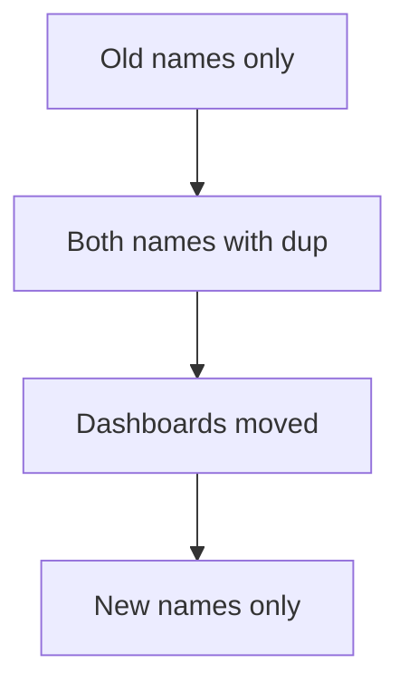

# Stability Levels And Migrating Names

A convention is not fixed on the day it is written. It has a **stability level**, and the level tells how much a user can rely on the name.

## Levels

| Level | Meaning |
| --- | --- |
| Development | The names can change, and a change can break users |
| Release candidate | The names are close to final |
| Stable | The names will not change in a way that breaks users |
| Deprecated | The name is replaced and will be removed in time |

Each attribute and each group of conventions has its own level. The HTTP conventions became stable first, and the conventions for databases followed. Before you build a dashboard on a name, check its level. A name at the development level can change in a release without a warning for the dashboard.

## Migrating a name

The HTTP convention moved from `http.method` to `http.request.method` and from `http.status_code` to `http.response.status_code`. The database convention moved from `db.statement` to `db.query.text`. A library that changes its names breaks every dashboard and alert that uses the old ones. The migration has a gradual path.

The instrumentation libraries read the environment variable `OTEL_SEMCONV_STABILITY_OPT_IN`. Its values for HTTP are:

| Value | Effect |
| --- | --- |
| Not set | The library emits the old names |
| `http` | The library emits only the new names |
| `http/dup` | The library emits both the old and the new names |

For databases the values are `database` and `database/dup`. Several values can be combined with commas. The path is: set `http/dup`, move dashboards and alerts to the new names, then set `http` to stop the old names.



The diagram shows the order of a safe migration.

## Rules for your own attributes

A name under a namespace of the team is stable only if the team makes it so. Write down the change in a changelog, keep the old name for a while, and remove it after the readers have moved.

## Decide in the playground

<!-- astrona:playground:renew -->

Read the names that arrive at the Collector and mark each as a resource attribute or as an operation attribute:

```sh
kubectl -n observability logs deploy/otel-collector --since=30s --tail=-1 | grep -E '^ +-> ' | sort -u
```

Decide which of the names are set by the program and which are added by the Collector after you add the `resourcedetection` processor. For each name that you use in a dashboard, decide the stability level you would accept.

The names now have an owner and a level. The lab sets up the detection in a cluster that starts without it.

## Common pitfalls

> [!WARNING]
> Do not build an alert on a development-level name without a plan to change it. Do not switch a library to the new names before the dashboards read them. Do not leave `dup` enabled forever: it doubles the volume of those attributes. Do not rename an attribute of your own without a notice period.
