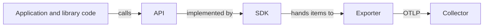

# API, SDK And Exporter: Who Does What

A program in the `starfleet` namespace, `shuttle-orders`, processes orders. Its authors want to know how long each order takes and how many orders are processed. To record this they call OpenTelemetry. The calls they write, the component that handles the calls, and the component that sends the result to a Collector are three separate things. This part explains each one and why the separation exists.

## Instrumentation

**Instrumentation** is code that makes a program emit telemetry. It can be written by hand in the application, supplied by a library, or added by a tool that wraps existing libraries. The result is the same: spans, metric data points and log records that leave the process.

## The API

The **API** is the set of interfaces that code calls to record telemetry. For traces, the code asks for a **tracer** and starts spans. For metrics, it asks for a **meter** and creates instruments such as a counter. These calls say what happened: an operation started, a value was added, an attribute was set.

The API does not decide what happens to that information. Without an implementation behind it, the API calls do nothing and cost almost nothing. A program that calls the API and has no SDK runs as before and produces no telemetry.

This is the reason library authors depend only on the API. A library for HTTP clients can call the API on every request. The application that uses the library decides whether any telemetry is produced and where it goes. A library that forced a specific SDK or backend would break every application that makes a different choice.

## The SDK

The **SDK** is the implementation of the API. It holds the rules that the application owner sets:

- The **resource**, which says which service the telemetry belongs to.
- The **sampler**, which decides which traces are recorded.
- **Processors** and **readers**, which collect finished spans, batch them and read metric aggregates at an interval.
- **Views**, which change how a metric is aggregated, for example by choosing histogram bucket boundaries or by removing an attribute.
- The **exporters** that send the data out.

The application owner sets up the SDK once, at start. Code that creates spans and counters does not change when the SDK settings change.

## The exporter

An **exporter** serializes telemetry and sends it to a destination. The OTLP exporter is the standard one. It can send over gRPC or over HTTP, and it sends to a Collector or to a backend that accepts OTLP. Other exporters write to a console or send to a vendor format. The choice of exporter is a deployment decision.



The diagram shows that code talks to the API only. Everything to the right of the API can change without a change to the code.

## Manual and automatic instrumentation

**Manual instrumentation** means that a developer writes API calls in the application. It records what only the application knows: the name of a business operation, the number of items in an order, the outcome of a decision. It requires effort and gives full control.

**Automatic instrumentation** adds the API calls without changes in the application code. In Python, an instrumentation package exists for each supported library, such as a web framework or a database client. Each package wraps the library so that its calls produce spans and metrics. A launcher called `opentelemetry-instrument` starts the program, loads the installed instrumentation packages and sets up the SDK from environment variables. In other languages the same effect comes from an agent or a loader that attaches to the process.

The two kinds work together. Automatic instrumentation gives breadth: every incoming request and every database call becomes a span. Manual instrumentation gives meaning: a span for `process-order` with the attribute `order.items`. The calls of both go through the same API and the same SDK, so their spans end up in one trace when one is active inside the other.

## The program in the playground

The program of `shuttle-orders` contains no setup code. It does these things:

- It asks for a tracer and a meter with the name `starfleet.orders`. The name becomes the **instrumentation scope** of the telemetry.
- In a loop, it starts a span `process-order`, sets the attribute `order.items`, starts a child span `reserve-stock`, and adds 1 to a counter `orders.processed` with the attribute `order.outcome`.

There is no code that creates an SDK or an exporter. The launcher creates them from the environment of the container.

<!-- astrona:playground:renew -->

Wait about one minute after the playground starts, because the pod first installs its packages. Check that the pod runs:

```sh
kubectl -n starfleet get pods
```

Read the program. It is stored in a ConfigMap:

```sh
kubectl -n starfleet get configmap orders-app -o jsonpath='{.data.app\.py}'
```

Find the lines that ask for the tracer and the meter, the two `start_as_current_span` calls and the `add(1, ...)` call. Look for any code that sets up an exporter and confirm that there is none.

Read the command that starts the container:

```sh
kubectl -n starfleet get deployment shuttle-orders -o jsonpath='{.spec.template.spec.containers[0].command}'
```

The last part of the command starts the program through `opentelemetry-instrument`. The packages that are installed before it include the distribution, which provides the defaults, and the OTLP exporter.

Now read what the Collector received:

```sh
kubectl -n observability logs deploy/otel-collector --since=60s --tail=-1
```

Find these facts in the output:

- A span named `process-order` and a span named `reserve-stock` with the same trace ID. The second one has the first one as its parent.
- The attribute `order.items` on the first span.
- The scope name `starfleet.orders`, which comes from the name given to `get_tracer` and `get_meter`.
- A metric `orders.processed` with a sum data point and the attribute `order.outcome`.

All of this was produced by code that calls the API only, together with a launcher that set up the SDK and the exporter.

## What to take from this

- Code calls the API. The SDK implements it, and an exporter sends the data out.
- Without an SDK, API calls produce nothing, so a library never forces a destination on an application.
- Automatic instrumentation gives breadth across known libraries, and manual instrumentation gives business meaning. Both use the same API and SDK.
- The instrumentation scope name comes from the name that the code gives to its tracer or meter.

## Common pitfalls

> [!WARNING]
> Do not assume that calling the API sends data. With no SDK behind it, the calls do nothing and report no error. Do not set up a second SDK inside a library: the application owns the SDK, and a library that creates its own causes duplicate or lost data. Remember that the pod needs about one minute to install its packages, so an empty Collector log right after start is expected.
