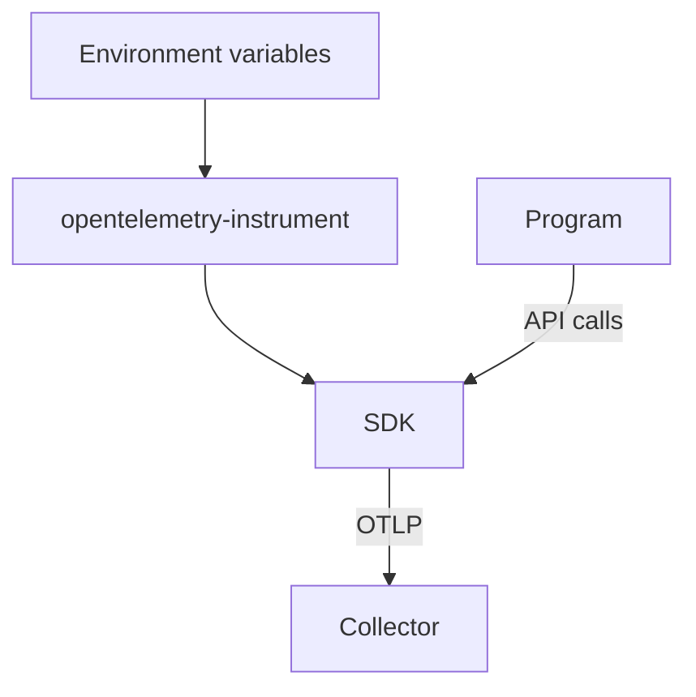

# Automatic Instrumentation And Environment Variables

The program `shuttle-orders` has no setup code, and it still sends spans and metrics to a Collector under the right service name. The launcher `opentelemetry-instrument` reads environment variables and builds the SDK from them. This part lists the variables that matter, explains what each one controls, and shows how one wrong value stops the data without an error in the program.

## How the launcher works

Automatic instrumentation in Python has three steps. The launcher starts first and reads the `OTEL_*` environment variables. It then creates the SDK: the resource, the sampler, the span processor, the metric reader and the exporters. Last, it loads the instrumentation packages that are installed for known libraries and starts the real program. When the program calls the API, the calls reach the SDK that the launcher built.

Because the SDK comes from the environment, an operator can change telemetry behavior by changing a Deployment, with no code change and no new image. This is also why a wrong value in the environment is a common cause of missing telemetry.



The diagram shows that the environment decides how the SDK is built, and the program only calls the API.

## The variables that identify the service

`OTEL_SERVICE_NAME` sets the resource attribute `service.name`. A program without a service name gets the placeholder `unknown_service`, with the process name after it in many SDKs. All dashboards that group by service then show an unnamed or wrong group.

`OTEL_RESOURCE_ATTRIBUTES` sets other resource attributes as a comma-separated list of `key=value` pairs, for example `deployment.environment.name=production,service.version=1.4.0`. If the list also contains `service.name`, the separate variable `OTEL_SERVICE_NAME` takes priority. A value that contains a comma or an equals sign needs percent-encoding.

## The variables that choose where data goes

`OTEL_EXPORTER_OTLP_PROTOCOL` selects the transport: `grpc`, `http/protobuf` or `http/json`. The two exporters speak different protocols on different ports. A Collector listens for gRPC on port 4317 and for HTTP on port 4318 by default.

`OTEL_EXPORTER_OTLP_ENDPOINT` selects the address. Two rules apply:

- With the HTTP protocols, the SDK appends the signal path to the base address: `/v1/traces`, `/v1/metrics` and `/v1/logs`. The variable holds the base address with a scheme, for example `http://otel-collector.observability:4318`.
- With `grpc`, the address names the host and port of the gRPC server, and the scheme tells the exporter whether to use TLS. A gRPC exporter that points at the HTTP port, or an HTTP exporter that points at the gRPC port, cannot complete a request.

The protocol and the endpoint must agree. This is the most frequent mistake in a hand-written setup: the protocol says `http/protobuf` and the endpoint names port 4317.

Per-signal variables override the general ones for one signal, for example `OTEL_EXPORTER_OTLP_TRACES_ENDPOINT`. A per-signal endpoint is used as written, so the signal path is not appended.

`OTEL_TRACES_EXPORTER`, `OTEL_METRICS_EXPORTER` and `OTEL_LOGS_EXPORTER` choose the exporter for each signal. The value `otlp` selects the OTLP exporter. The value `none` turns the signal off. The playground sets `OTEL_LOGS_EXPORTER` to `none`, so the program exports spans and metrics only.

`OTEL_METRIC_EXPORT_INTERVAL` sets how often the metric reader exports, in milliseconds. The default is 60000. A short interval, such as the 5000 in the playground, makes metrics appear in a Collector log quickly. It also sends more requests.

## The variables that choose what is recorded

`OTEL_TRACES_SAMPLER` selects the sampler. The values are `always_on`, `always_off`, `traceidratio`, `parentbased_always_on`, `parentbased_always_off` and `parentbased_traceidratio`. The default is `parentbased_always_on`. A **parent-based** sampler follows the decision of the parent span when the trace came from another service, and applies its own rule only to new traces. `OTEL_TRACES_SAMPLER_ARG` sets the ratio for the ratio samplers, as a number from 0 to 1.

`OTEL_SDK_DISABLED` set to `true` turns the SDK off completely. The API calls remain in the code and become no-operations, so the program produces no spans, no metrics and no logs.

The sampler only affects traces. A program with `always_off` still exports metrics, because metrics are aggregated by a separate reader and do not depend on spans.

## One wrong value, one silent failure

Several mistakes give the same symptom: the Collector receives nothing under the expected name.

- The endpoint port does not match the protocol. The exporter fails to send, and the SDK logs an export error in the program log, not in the Collector.
- The service name is missing. The data arrives under `unknown_service`, so a search for the real name finds nothing.
- The sampler is `always_off` or a ratio of 0. Spans are created by the code and never recorded or exported, while metrics continue.
- `OTEL_SDK_DISABLED` is `true`. Nothing is exported at all.
- A per-signal variable overrides the general one for one signal. The other signals still work, which makes the failure look partial.

The program log and the Collector log are the two places to look. A sender-side error shows in the program log. A Collector log that shows nothing for a service points to a sender, an endpoint or a sampler problem, and a Collector log that shows the data with a wrong name points to a resource problem.

## Change the environment in the playground

<!-- astrona:playground:renew -->

Print the current environment of the container:

```sh
kubectl -n starfleet get deployment shuttle-orders -o jsonpath='{.spec.template.spec.containers[0].env}'
```

Match each variable to what you just read. Then change the service name. `kubectl set env` edits the Deployment and starts a new pod, which again installs its packages and takes about one minute:

```sh
kubectl -n starfleet set env deployment/shuttle-orders OTEL_SERVICE_NAME=shuttle-billing
kubectl -n starfleet rollout status deployment/shuttle-orders
```

Wait about one minute and read the Collector log:

```sh
kubectl -n observability logs deploy/otel-collector --since=30s --tail=-1
```

Find `service.name` under `Resource attributes:`. It now has the value `shuttle-billing`. Set it back to `shuttle-orders` with the same command when you are finished.

Next, break the protocol and the endpoint on purpose. Set the endpoint to the gRPC port while the protocol stays `http/protobuf`:

```sh
kubectl -n starfleet set env deployment/shuttle-orders OTEL_EXPORTER_OTLP_ENDPOINT=http://otel-collector.observability:4317
kubectl -n starfleet rollout status deployment/shuttle-orders
```

Wait one minute and read the Collector log again. No items from `shuttle-orders` appear. Read the program log to see the sender side:

```sh
kubectl -n starfleet logs deploy/shuttle-orders --tail=20
```

Look for an export error. The exact text depends on the SDK version, so read it and do not expect a specific sentence. Restore the port 4318 with the same `set env` command.

Finally, set the sampler to `always_off`:

```sh
kubectl -n starfleet set env deployment/shuttle-orders OTEL_TRACES_SAMPLER=always_off
kubectl -n starfleet rollout status deployment/shuttle-orders
```

After about one minute, spans stop in the Collector log and the `orders.processed` metric continues. Remove the variable with `kubectl -n starfleet set env deployment/shuttle-orders OTEL_TRACES_SAMPLER-`, where the trailing minus deletes the variable.

You now know which variable controls which part of the SDK, and that a wrong value fails without a message in the Collector. The open question is how to decide what the program should measure at all.

## Common pitfalls

> [!WARNING]
> Do not mix a protocol and a port: `http/protobuf` needs the HTTP port 4318 and `grpc` needs 4317. Do not read an empty Collector log as proof that the program is healthy. Look at the program log for export errors, and check the sampler and `OTEL_SDK_DISABLED`. Do not forget that a new pod needs about one minute to install its packages before it can send anything.
