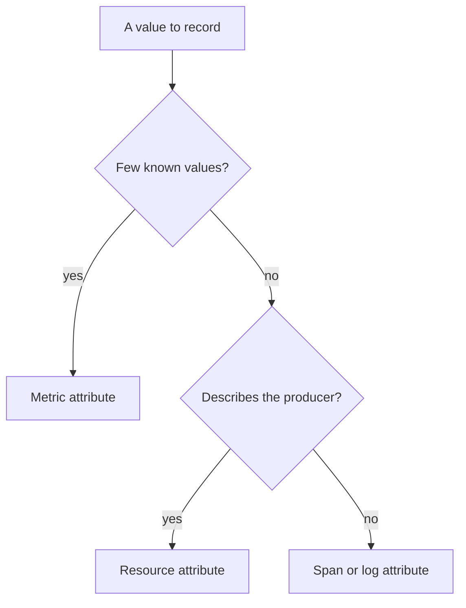

# Designing Useful Measurements

A program that emits everything is as hard to use as a program that emits nothing. Too many spans hide the slow operation, too many metric series overload the backend, and one careless attribute can expose personal data. This part explains how to choose the boundaries to instrument, the right instrument for each measurement, and the names, units and attributes that keep telemetry useful, bounded and safe.

## Choose spans at operation boundaries

A span should describe an operation that someone could ask about: an incoming request, a call to another service, a database query, a message that is published or consumed, a unit of background work. These are the places where time is spent waiting or where a failure can start.

A span for every function call is a poor choice. It makes the trace large, adds overhead to the program, and hides the slow operation in a long list of tiny ones. A good test is to ask which question the span answers. If no question needs the span, leave it out.

Automatic instrumentation already creates spans for incoming requests and for calls that go through known libraries. Adding a manual span around the same call creates a duplicate: two spans with the same meaning, one nested in the other, and a trace that looks slower or deeper than it is. Add manual spans only for work that the automatic instrumentation cannot see, such as a business step like `process-order` or `reserve-stock`.

## Choose the instrument for the question

Each metric instrument fits one kind of question:

- A **counter** answers how many times something happened, such as orders processed. It only goes up. The rate of the counter gives events per second.
- An **up-down counter** tracks a quantity that can fall, such as the number of jobs in a queue.
- A **gauge** records a value that is read at a moment, such as the temperature or the current size of a cache.
- A **histogram** answers how long or how large, such as the duration of a request. It gives the count, the sum and the bucket distribution, so a percentile can be estimated.

Using the wrong instrument makes the question unanswerable. An average duration stored in a gauge hides the slow tail. A count stored as a gauge cannot be turned into a reliable rate after a restart. Use a histogram for durations and sizes, and a counter for events.

## Names and units

A metric name should say what it measures and not how it was made. The unit is a separate field, written in the Unified Code for Units of Measure style: `s` for seconds, `By` for bytes, and braces for a countable thing, such as `{order}`. The counter in the playground, `orders.processed`, has the unit `{order}`. A name does not repeat the unit, so the metric is called `orders.processed` and not `orders_processed_total_count`.

A span name describes a class of operation, such as `process-order`, and it never contains an identifier such as an order number. Metric names and span names that contain identifiers grow without limit.

## Choose attributes with a bounded number of values

Every attribute on a metric multiplies the number of series. The counter `orders.processed` with the attribute `order.outcome` that has two values makes two series. The same counter with an attribute for the customer makes one series per customer, which can be thousands. A backend charges for series, and it can drop data when the count grows too far.

The rule for metrics is to use attributes with a small and known set of values: an outcome, a route template, a status class. Put values that are searched for, such as an order number or a user identifier, on spans or logs, where each item is stored once and not aggregated.



The diagram shows the order of the questions that decide where a value goes.

## Keep sensitive values out

A span attribute, a log body and an exception message can hold personal data, access tokens, passwords and card numbers. Once such a value is recorded, it travels through the SDK, the network, the Collector and the backend, and it stays in storage for the retention period. Do not record a value that the telemetry does not need. Instrumentation libraries often offer switches to leave out query strings and headers, and some attributes are marked as opt-in in the conventions for exactly this reason.

For values that must be kept for troubleshooting, record a safe stand-in, such as an internal identifier that has no meaning outside the system, and keep the sensitive value in the system that owns it.

## Propagation across services

Spans of different services join one trace only when the context travels with the request. For HTTP, the W3C Trace Context standard carries it in the `traceparent` header. Instrumentation libraries for HTTP clients add the header, and server libraries read it. A service that makes outgoing calls with a library that is not instrumented does not forward the header, and the trace breaks into two. The default propagator in the SDK is `tracecontext` together with `baggage`, and `OTEL_PROPAGATORS` changes it.

## Look at measurement choices in the playground

<!-- astrona:playground:renew -->

Print the metric that the program records and its unit:

```sh
kubectl -n observability logs deploy/otel-collector --since=60s --tail=-1
```

Find the metric `orders.processed`. Read its unit and its data point attribute `order.outcome`. Decide how many series the metric creates and what would happen if the attribute held an order number.

Now see what a poor span name does. The program reads its span name from the variable `WORK_NAME`. Put an identifier in it:

```sh
kubectl -n starfleet set env deployment/shuttle-orders WORK_NAME=process-order-10442
kubectl -n starfleet rollout status deployment/shuttle-orders
```

After about one minute, read the Collector log again and find the span name. It now contains the number. In a real program the number changes with every order, so every order would create a new name. Restore the correct name with `kubectl -n starfleet set env deployment/shuttle-orders WORK_NAME=process-order`.

Finally, turn the SDK off and observe what the program still does:

```sh
kubectl -n starfleet set env deployment/shuttle-orders OTEL_SDK_DISABLED=true
kubectl -n starfleet rollout status deployment/shuttle-orders
kubectl -n starfleet get pods
```

The pod stays in the state `Running`, so the program still runs its loop. After one minute, the Collector log shows no new items from `shuttle-orders`. The API calls are no-operations without an SDK. Remove the variable with `kubectl -n starfleet set env deployment/shuttle-orders OTEL_SDK_DISABLED-`.

You now have the rules that connect the questions of a team to the spans, instruments and attributes of a program. The remaining step is to apply them when the configuration is wrong in a running system.

## Common pitfalls

> [!WARNING]
> Do not add a manual span around a call that automatic instrumentation already records: the trace gets a duplicate. Do not use an identifier, a URL with a query string or an email address as a metric attribute or a span name. Do not record personal data or secrets in attributes, log bodies or exception messages, because every component after the program stores them.
