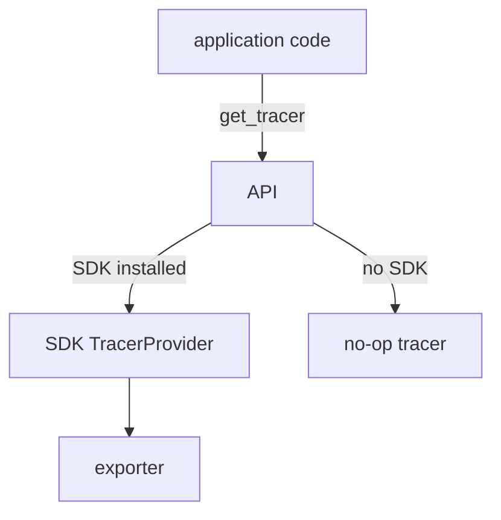

# Tracers, Meters And Instrumentation Scope

Code that creates telemetry does not talk to a backend. It asks the OpenTelemetry API for a tracer or a meter and calls methods on it. What happens next depends on the SDK that the application installed. This part explains how code gets those objects, what name and version it passes and why, and what happens when no SDK is installed.

## Providers, tracers and meters

The API defines three kinds of **providers**: a `TracerProvider`, a `MeterProvider` and a `LoggerProvider`. A provider is the object that holds the configuration for one signal. A **tracer** is an object, created by a tracer provider, with the methods that start spans. A **meter** is created by a meter provider and has the methods that create metric instruments.

The application sets up the providers once, usually at start. The `opentelemetry-instrument` launcher or the application's own start-up code creates the SDK providers and registers them as the **global providers**. Library code does not create providers. It asks the API for the global one:

```python
from opentelemetry import metrics, trace

tracer = trace.get_tracer("starfleet.orders", "1.4.0")
meter = metrics.get_meter("starfleet.orders", "1.4.0")
```

The two calls return a tracer and a meter from the global providers. The first argument is the name and the second is the version of the code that creates the telemetry.

## Instrumentation scope

The name and the version identify the **instrumentation scope**. The scope names the library or module that produced the telemetry. It is not the service. A service named `shuttle-orders` can use one scope for its own code, `starfleet.orders`, and another scope for the HTTP library that it uses.

The SDK writes the scope on every span and metric. In OTLP the scope sits between the resource and the items, so a backend can filter by library. Use the name of the package or the module. A stable name matters because it is the key for filtering, for example "drop all spans of the scope `noisy.cache`". A scope can also carry a schema URL that tells which version of the semantic conventions the attribute names follow.

## The API without an SDK

The API is safe to call when no SDK is installed. In that case the global provider is a no-op provider. A **no-op** (no operation) object accepts every call and does nothing. A span started from a no-op tracer is not recorded and costs almost nothing. This is the reason a library author can add instrumentation to a library without forcing any dependency on the application: the library depends on the API package only. When the application installs the SDK and registers the providers, the same library calls start to produce data.

The reverse is a common mistake. An application that depends only on the API and never installs the SDK produces no telemetry, and nothing reports an error. The environment variable `OTEL_SDK_DISABLED=true` creates the same effect on purpose.



The diagram shows that the code calls the same API in both cases, and that the SDK decides whether anything is recorded.

## Read the scope in the playground

<!-- astrona:playground:renew -->

The program `shuttle-orders` calls `get_tracer` and `get_meter` with the name `starfleet.orders` and the version `1.4.0`. Read the Collector output:

```sh
kubectl -n observability logs deploy/otel-collector --since=60s --tail=-1 | grep -E 'ScopeSpans|ScopeMetrics|InstrumentationScope'
```

The pod needs about one minute after it starts to install its packages before the first items appear. Each line names the scope, with the name and the version. Find the scope of the spans and the scope of the metrics, and check that both name `starfleet.orders`. Then look at the resource attributes above them and confirm that `service.name` is a different thing: the service is `shuttle-orders` and the scope is `starfleet.orders`.

Now turn the SDK off and see the difference. Set the variable and wait for the new pod:

```sh
kubectl -n starfleet set env deployment/shuttle-orders OTEL_SDK_DISABLED=true
kubectl -n starfleet rollout status deployment/shuttle-orders
```

Read the Collector output after another minute. The program still runs its loop, and no new items arrive. Remove the variable to restore the telemetry:

```sh
kubectl -n starfleet set env deployment/shuttle-orders OTEL_SDK_DISABLED-
```

## What to take from this

Code asks the API for a tracer or a meter by name and version, and the SDK decides what happens to the calls. The name and version form the instrumentation scope, which names the code that produced the data and is separate from the service. Without an SDK the API does nothing and reports nothing. The next question is what code does with a tracer once it has one: how it starts and ends a span.

## Common pitfalls

> [!WARNING]
> Do not use the service name as the scope name, because the two answer different questions. Do not create a new tracer for every request when one module-level tracer is enough. Do not conclude that the Collector is broken when an application has no SDK: no SDK means no data.
