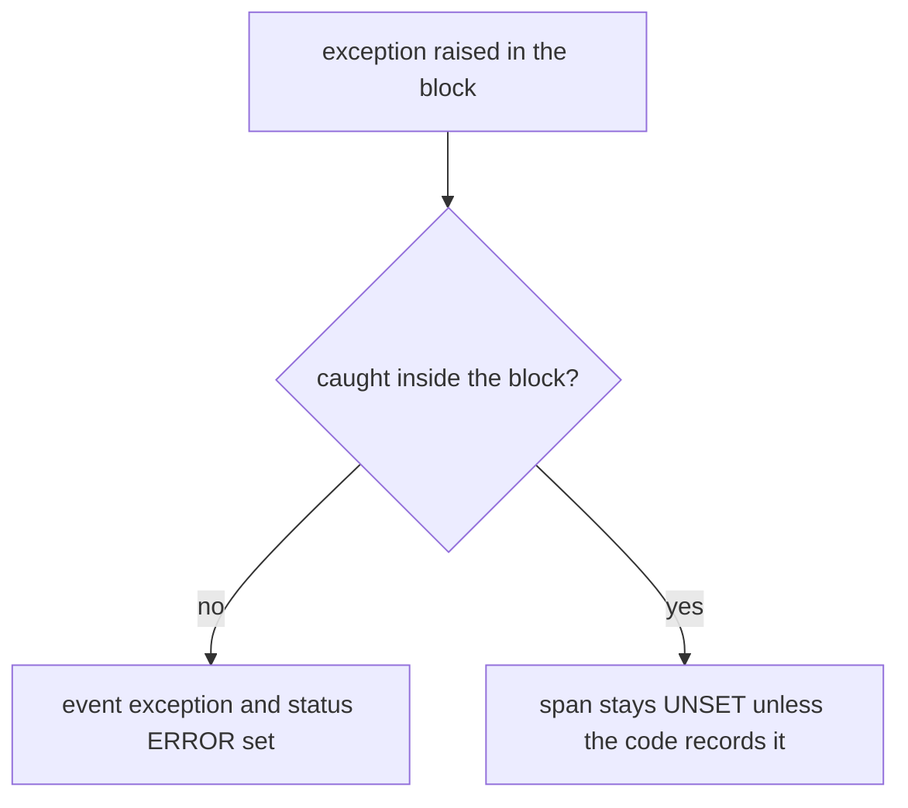

# Events, Exceptions And Span Status

An operation can fail, retry or take an unusual path. A span with only a name and a duration does not say what went wrong. This part shows how code records moments inside a span with events, how it records exceptions, and how it sets the status so that a backend can count failures.

## Events

A span **event** is a note with a name, a timestamp and attributes. Add one with `add_event`:

```python
span.add_event("order received", {"order.items": items})
```

An event records something at one moment inside the span, for example "cache miss" or "retry 2". A span has one start and one end, and events fill the time between. Events belong to one span. For data about the whole operation, use an attribute.

## Recording an exception

When code catches an exception, `record_exception` adds an event named `exception`:

```python
try:
    reserve_stock(items)
except ValueError as error:
    span.record_exception(error)
```

The event has the attributes `exception.type`, `exception.message` and `exception.stacktrace`. Recording the exception does not mark the span as failed. A program can handle an exception and still finish the operation, so the status must be set by the code that knows the outcome.

## Span status

The status has three values: `UNSET`, `OK` and `ERROR`. Set it with `set_status`:

```python
from opentelemetry.trace import Status, StatusCode

span.set_status(Status(StatusCode.ERROR, "not enough stock"))
```

The description is used only with `ERROR`. Set `ERROR` when the operation failed. Leave `UNSET` for success. Set `OK` only when a decision must override an `ERROR` that something else set. Once a span is `OK`, later calls cannot change it.

## What `start_as_current_span` does for you

The context manager records an exception that leaves the block and sets the status to `ERROR` with the exception message. This is the default behavior, and two arguments can switch it off: `record_exception=False` and `set_status_on_exception=False`. This default protects a span from silently looking successful when its code crashed.

But the default works only for exceptions that leave the block. A `try` and `except` that catches the exception inside the block hides it from the context manager. The span then ends with `UNSET`, and no event is recorded. This is one of the most common reasons why failures are missing from traces: the code handled the error and nobody told the span.



The diagram shows that the same exception leaves a different trace depending on where it is caught.

## See the difference in the playground

<!-- astrona:playground:renew -->

The playground program rejects an order when `reserve_stock` raises a `ValueError`. It catches the exception in the outer block and then records it and sets the status itself. Count the error spans and the exception events in 60 seconds:

```sh
kubectl -n observability logs deploy/otel-collector --since=60s --tail=-1 | grep -c 'Status code *: Error'
kubectl -n observability logs deploy/otel-collector --since=60s --tail=-1 | grep -c -- '-> Name: exception'
```

Both numbers are above 0 when at least one order was rejected in the window. Wait and count again if they are 0, because the program rejects about one order in five.

Look at one exception event with its attributes:

```sh
kubectl -n observability logs deploy/otel-collector --since=120s --tail=-1 | grep -A8 -- '-> Name: exception' | head -20
```

Find `exception.type` and `exception.message`. Notice that two spans carry an exception for one rejected order: the inner `reserve-stock` span, where the context manager recorded it automatically, and the outer `process-order` span, where the code recorded it by hand.

## What to take from this

Events record moments, `record_exception` records the exception details and `set_status` records the outcome. A context manager does the recording for an exception that leaves the block, and an exception caught inside the block needs explicit calls. A reader should count failures by the status, and look at the exception event for the cause. The last piece of manual instrumentation is the metric.

## Common pitfalls

> [!WARNING]
> Do not catch an exception and move on without recording it, because the span then looks successful. Do not set `OK` on every span, because it hides failures that other code sets later. Do not put secrets in an exception message, because the message is exported.
