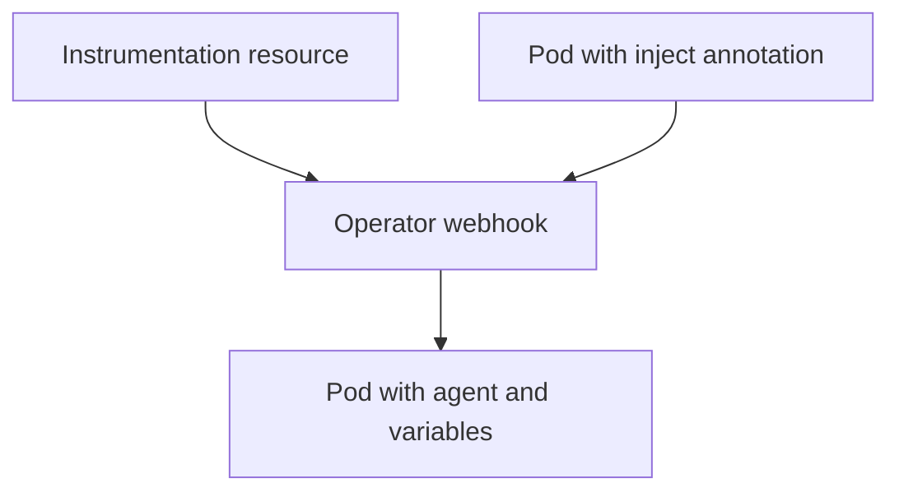

# Zero-Code Instrumentation

**Zero-code instrumentation** adds telemetry to a program without a change in its source. A component loaded at start patches the libraries that the program uses, and the patched libraries create spans and metrics.

## How it works per language

| Language | How it loads |
| --- | --- |
| Java | The JVM option `-javaagent:` with the OpenTelemetry Java agent JAR |
| Python | The wrapper command `opentelemetry-instrument` |
| Node.js | A required module, for example `--require` with the auto-instrumentations package |
| .NET | Startup hooks that the instrumentation package provides |
| Go | An eBPF-based agent that runs next to the program |

Each loader finds the supported libraries, such as a web framework or an HTTP client, and wraps their calls. The program code is unchanged. What the program gets is spans for incoming and outgoing requests and calls to databases, and in some languages metrics and logs.

## Configure with environment variables

The behavior is set with environment variables that all SDKs share:

| Variable | Purpose |
| --- | --- |
| `OTEL_SERVICE_NAME` | The service name |
| `OTEL_EXPORTER_OTLP_ENDPOINT` | Where to send data |
| `OTEL_EXPORTER_OTLP_PROTOCOL` | `grpc`, `http/protobuf` or `http/json` |
| `OTEL_TRACES_EXPORTER`, `OTEL_METRICS_EXPORTER`, `OTEL_LOGS_EXPORTER` | An exporter name, or `none` |
| `OTEL_PROPAGATORS` | The context formats |
| `OTEL_TRACES_SAMPLER` | The sampler |

In Python, the wrapper needs the instrumentation package of each library. The command `opentelemetry-bootstrap` finds the installed libraries and lists or installs the matching packages. In the playground the packages for Flask and requests are installed by name.

## The OpenTelemetry Operator

In Kubernetes the OpenTelemetry Operator injects the agent. An `Instrumentation` resource holds the exporter endpoint, the propagators and the sampler. A pod then asks for injection with an annotation such as `instrumentation.opentelemetry.io/inject-python: "true"`. The Operator adds an init container that copies the agent and sets the environment variables. The application image stays unchanged.



The diagram shows that the Operator changes the pod at creation time.

## Limits

Zero-code instrumentation sees library calls and does not know the business meaning. It cannot create a span called `reserve-stock` or an attribute with an order value. For that the program uses the API, as in the module on manual instrumentation. The two approaches are combined: the agent covers the libraries and the code adds the specific parts.

## See it in the playground

<!-- astrona:playground:renew -->

The Deployments `shuttle-client` and `shuttle-billing` in `starfleet` run under `opentelemetry-instrument`. Wait until both pods are ready, which takes about a minute, and show the variables of the server:

```sh
kubectl -n starfleet rollout status deployment/shuttle-billing --timeout=300s
kubectl -n starfleet get deployment shuttle-billing -o jsonpath='{.spec.template.spec.containers[0].env}'
```

Read the spans in the Collector log and find the ones with the kind Server and Client:

```sh
kubectl -n observability logs deploy/otel-collector --since=60s --tail=-1 | grep -E 'Name|Kind'
```

Neither service has a line of tracing code for HTTP, yet the spans exist. The next part is about how the two services share one trace.

## Common pitfalls

> [!WARNING]
> Do not expect business spans from an agent. Do not install the agent and an SDK setup for the same library at the same time, because this can create duplicate spans. Do not forget the instrumentation package for a library, because the wrapper then skips it without an error. Do not set an endpoint that the pod cannot reach.
