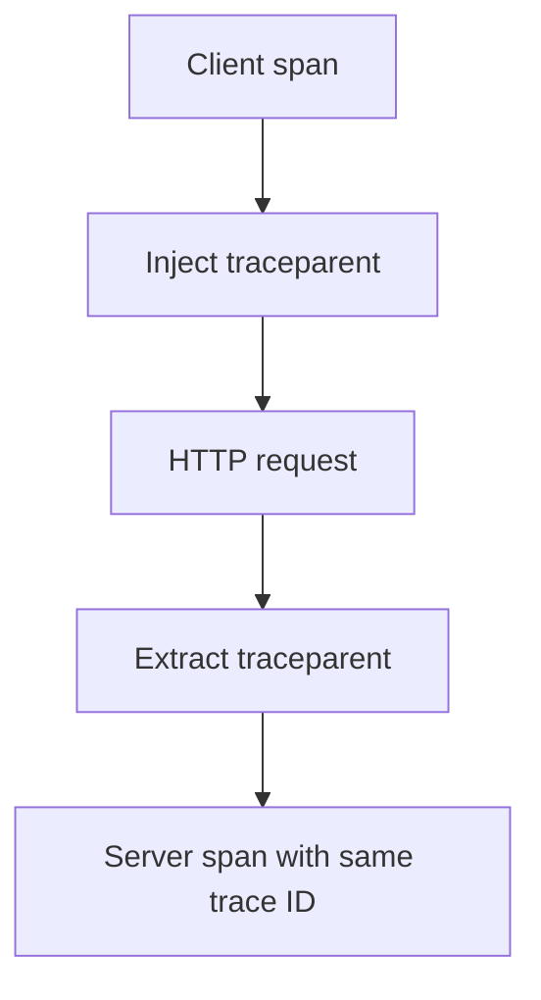

# Context Propagation And Propagators

A trace that spans two services needs one trace ID in both. The client must send the trace ID and its own span ID in the request, and the server must read them. This is **context propagation**.

## The traceparent header

The W3C Trace Context standard defines the header `traceparent`. It has four fields separated by dashes:

```text
traceparent: <version>-<trace-id>-<parent-span-id>-<flags>
```

The version is `00`, the trace ID has 32 hex characters, the parent span ID has 16 hex characters, and the flags field says among other things whether the trace is sampled. A second header, `tracestate`, carries vendor data.

## What a propagator does

A **propagator** has two functions. On the client side it injects the current context into the headers of the outgoing request. On the server side it extracts the context from the incoming headers, so the new server span gets the same trace ID and the client span as its parent. The instrumentation for an HTTP client calls inject, and the instrumentation for a web framework calls extract.



The diagram shows inject on one side and extract on the other.

## Choosing propagators

`OTEL_PROPAGATORS` is a comma-separated list. The default is `tracecontext,baggage`.

| Value | Format |
| --- | --- |
| `tracecontext` | W3C `traceparent` and `tracestate` |
| `baggage` | W3C `baggage` header |
| `b3` | One header `b3` from Zipkin |
| `b3multi` | Several headers, `X-B3-TraceId` and others |
| `jaeger` | The header `uber-trace-id` |
| `none` | No propagation |

Both sides must understand at least one common format. A client that sends only `b3` and a server that reads only `tracecontext` produce two separate traces, with no error and no warning. Mixed systems often list two formats, for example `tracecontext,b3`: injection then writes both, and extraction uses the first one that finds a context.

## The symptom of broken propagation

When extraction fails, the server starts a new trace. Its span has no parent and a new trace ID, and the client span stays alone in its trace. Each side looks healthy by itself. The sign is a server span with no parent where a caller is known to exist.

## Check it in the playground

<!-- astrona:playground:renew -->

Show the parent and the trace ID of the server span and the client span:

```sh
kubectl -n observability logs deploy/otel-collector --since=30s --tail=-1 | grep -E 'Trace ID|Parent ID|Kind' | head -12
```

A server span with the kind Server has a parent ID that is not empty, and its trace ID matches that of a span with the kind Client. Change the server to `none` and compare after the pod restarts:

```sh
kubectl -n starfleet set env deployment/shuttle-billing OTEL_PROPAGATORS=none
kubectl -n starfleet rollout status deployment/shuttle-billing --timeout=300s
```

Wait about 30 seconds and read the log again. The server spans now have an empty parent ID. Set the value back to `tracecontext,baggage` when you are done.

The trace is now connected by a header. The next part adds data to the same path.

## Common pitfalls

> [!WARNING]
> Do not mix formats on the two sides without a shared one. Do not set `none` on a service in the middle of a call chain, because this breaks the trace for every service behind it. Do not assume that a proxy forwards unknown headers. Do not look for the fault in the exporter first: the data arrives, only the connection is missing.
