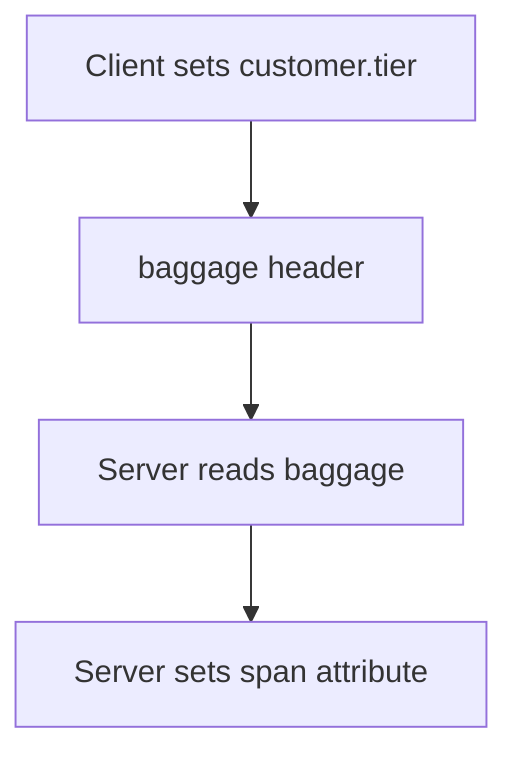

# Baggage

**Baggage** is a set of key-value pairs that travels with the request, in the header `baggage`, across all services of the call chain. It is part of the context, like the trace ID, but it is not a span attribute.

## What baggage is for

A value that is known at the edge of the system can be needed deep inside. Examples are a customer tier, a tenant name or the origin of a request. With baggage, each service can read the value without an extra call or a changed API.

## The rule that surprises most users

Baggage is not added to spans, metrics or logs by itself. A key in the baggage is visible only to code that reads it. To see it in the telemetry, a service must copy it to an attribute. In the playground, the server reads `customer.tier` from the baggage and sets it as a span attribute. A Collector or an SDK can also copy baggage to attributes with a span processor.



The diagram shows that the value needs an explicit copy to appear in the data.

## Risks and limits

- Baggage goes in a header to every service the request reaches, including third parties. Never put secrets or personal data in it.
- The header is limited in size. Keep few keys and short values.
- A service that receives baggage can read it and set it again. Treat the values as input that is not trusted.
- Each propagated key costs bytes on every call.

## Baggage and attributes compared

| Property | Baggage | Span attribute |
| --- | --- | --- |
| Travels to other services | Yes | No |
| Visible in the backend | Only after a copy | Yes |
| Needs the `baggage` propagator | Yes | No |

If the propagator list has no `baggage`, the client does not send the header and the server finds nothing. The default list includes it.

## Check it in the playground

<!-- astrona:playground:renew -->

The client sets `customer.tier` to `gold`. Find the attribute on the server span:

```sh
kubectl -n observability logs deploy/otel-collector --since=30s --tail=-1 | grep 'customer.tier'
```

You should see `customer.tier: Str(gold)`. Set the server propagators to `tracecontext` only, wait for the new pod, and read again. The attribute has the value `none`, because the server reads no baggage. The trace stays connected, because `tracecontext` is still there. Restore `tracecontext,baggage` afterward.

The context now carries two kinds of data. The next part is about the decision to record a trace.

## Common pitfalls

> [!WARNING]
> Do not put secrets or personal data in baggage. Do not expect baggage keys to appear in the backend without a copy. Do not remove `baggage` from the list and then look for the missing value in the code. Do not send large values: the header size is limited.
