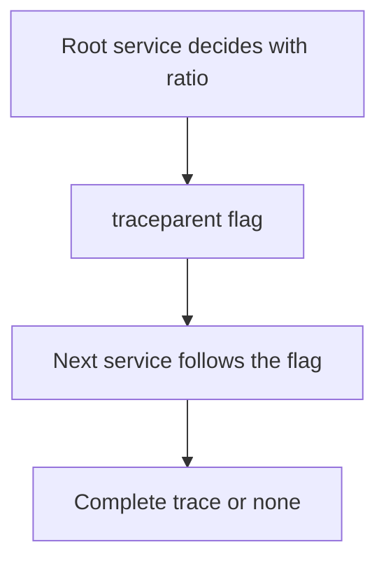

# Samplers And Parent-Based Decisions

Recording every trace is costly. A **sampler** in the SDK decides when a span is recorded and exported. The decision is made at the start of a trace, at the root span, and the other services follow it.

## Built-in samplers

| `OTEL_TRACES_SAMPLER` | Behavior |
| --- | --- |
| `always_on` | Record every span |
| `always_off` | Record no span |
| `traceidratio` | Record a fixed fraction based on the trace ID |
| `parentbased_always_on` | Follow the parent; with no parent, record |
| `parentbased_always_off` | Follow the parent; with no parent, do not record |
| `parentbased_traceidratio` | Follow the parent; with no parent, use the ratio |

The ratio is set with `OTEL_TRACES_SAMPLER_ARG`, for example `0.1` for one trace in ten. The default sampler is `parentbased_always_on`.

## Why parent-based

A trace is useful only when all its spans are kept. If each service rolls its own dice with `traceidratio`, the ratio applies to the trace ID, so all services choose the same traces if they use the same ratio; but a service with a different ratio breaks the pattern. A parent-based sampler is more robust: only the first service decides, and the others read the decision from the sampled flag in the `traceparent` header.



The diagram shows that one decision travels with the context.

## Sampling and broken propagation

If propagation is broken, the parent-based sampler sees no parent on the server side. It then acts as a root and decides on its own, so the ratio is applied twice and the traces come out incomplete. A trace with a missing half is often a propagation problem and not a sampling problem. The check of the previous part comes first.

## Head and tail sampling

The SDK sampler is **head sampling**: the decision is made before the result of the trace is known. It cannot keep all error traces. **Tail sampling** in the Collector decides after the trace is complete, as the module on traces showed. Teams often use a parent-based ratio in the SDK together with tail sampling in a Collector.

## Read the setting in the playground

<!-- astrona:playground:renew -->

The services use the default sampler. Show that no sampler variable is set, and then set a ratio on the client:

```sh
kubectl -n starfleet get deployment shuttle-client -o jsonpath='{.spec.template.spec.containers[0].env[*].name}'
kubectl -n starfleet set env deployment/shuttle-client OTEL_TRACES_SAMPLER=parentbased_traceidratio OTEL_TRACES_SAMPLER_ARG=0.5
```

After the new pod runs for a minute, count the client spans in the log. About half as many appear as before, and every server span that arrives has a client span with the same trace ID, because the server follows the flag. Remove the two variables when you are done:

```sh
kubectl -n starfleet set env deployment/shuttle-client OTEL_TRACES_SAMPLER- OTEL_TRACES_SAMPLER_ARG-
```

The lab applies what the parts showed in a system with a broken trace.

## Common pitfalls

> [!WARNING]
> Do not use plain `traceidratio` in a service that is not the root. Do not set different ratios in different services and expect complete traces. Do not change a ratio and judge a rate over a few seconds. Do not blame the sampler for a trace that is cut in two before you check the propagators.
