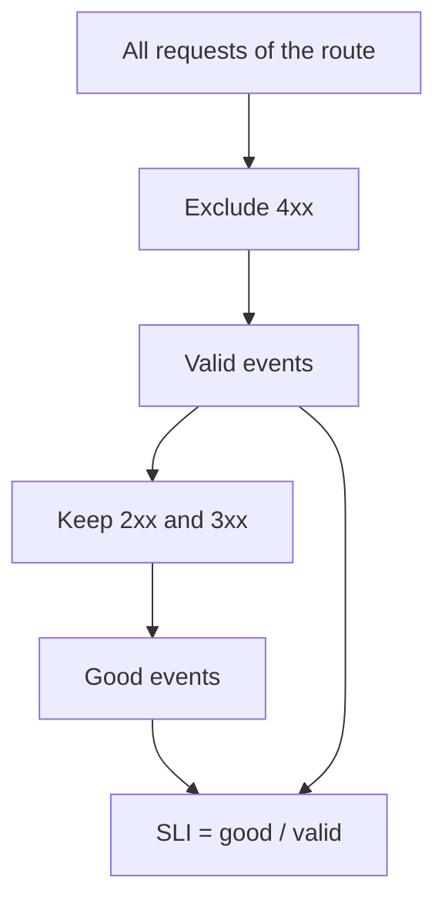

# SLIs, SLOs And SLAs: Defining Good And Valid Events

Telemetry tells you what a system did. A decision needs a rule that says whether that behavior is good enough. This part defines the three terms that make the rule: the service level indicator, the service level objective and the service level agreement. It then calculates an indicator from counters that Prometheus has stored for a service named `bridge`.

## Three terms with three jobs

A **service level indicator (SLI)** is a measurement of one aspect of a service, written as a ratio. It is the number of good events divided by the number of valid events, usually expressed as a percentage. An SLI describes what happened.

A **service level objective (SLO)** is the target value for an SLI over a time window. "99.5 percent of valid requests to `/orders` succeed, measured over 30 days" is an SLO. An objective is an internal goal, and it decides when the team must act.

A **service level agreement (SLA)** is a contract with a customer that states a service level and the consequence of missing it, such as a refund. An SLA is usually looser than the SLO behind it, so that the team can react before the contract is broken. A service can meet its SLO and miss nothing, miss its SLO and still meet its SLA, or miss its SLA, and each case needs a different response.

## Good events and valid events

An SLI is only as meaningful as its two populations.

**Valid events** are the events that count. Everything that should not count is excluded here. **Good events** are the valid events that went well. The SLI is good divided by valid.

Take the counter `http_requests_total` of `bridge`, which has the labels `service`, `route` and `code`. A reasonable availability SLI for one route is:

- Population: requests with the label `route="/status"`.
- Valid events: all requests of the population except those with a `4xx` code. A `4xx` code means that the client sent a bad request, so the service did nothing wrong.
- Good events: requests with a `2xx` or `3xx` code.
- Bad events: valid requests that are not good, which means `5xx` codes.

The definition is a decision, and a different team can choose a different one. Some teams count `429` responses as bad, because a service that rejects traffic is unavailable to those users. The important point is to write the definition down, because two readers with different definitions get different numbers from the same data.

An SLI needs a **window**: the period over which the ratio is evaluated. Common windows are a rolling 28 or 30 days, or a calendar month. A rolling window moves with time and shows recent behavior. A calendar window resets and makes monthly reports simple.

## The SLI in PromQL

Prometheus stores counters as time series. **PromQL** is its query language. These two expressions give the valid and the good events for `/status` as the current counter values:

```
sum(http_requests_total{route="/status", code!~"4.."})
sum(http_requests_total{route="/status", code=~"2..|3.."})
```

The matcher `=~` compares a label with a regular expression, and `!~` negates it. A regular expression in Prometheus must match the whole value, so `4..` matches `400` to `499`. The function `sum` adds up the series that remain.

The SLI as a ratio of the two:

```
sum(http_requests_total{route="/status", code=~"2..|3.."}) / sum(http_requests_total{route="/status", code!~"4.."})
```

For a live service, the counters grow without limit, so a ratio of the raw totals averages over the whole life of the counter. A real SLI uses `increase` or `rate` over the window, for example `sum(increase(http_requests_total{route="/status", code=~"2..|3.."}[30d]))`. The playground serves fixed counters, so the raw totals are the right input here.



The diagram shows that the denominator is built first, and the numerator is a subset of it.

## Compare the SLI with the SLO

The SLI is compared with the SLO target. If the SLO is 99.9 percent, an SLI of 99.80 percent misses the target. The comparison is the first piece of information an on-call team needs. It does not say why the service missed. The reason comes from traces and logs, and the SLI tells the team that the question is worth asking.

## Calculate an SLI in the playground

<!-- astrona:playground:renew -->

Prometheus in `observability` scrapes the job `bridge`. Check that the target is up. A query returns the value 1 for a healthy target:

```sh
kubectl -n observability exec deploy/prometheus -- wget -qO- 'http://localhost:9090/api/v1/query?query=up'
```

The output is JSON. Find the field `value` in the result. The second item of the pair is the string `1`.

List the counters of `/status` per code. Characters such as the quote, the braces and the slash must be URL encoded: `%22` for `"`, `%7B` for `{`, `%7D` for `}` and `%2F` for `/`:

```sh
kubectl -n observability exec deploy/prometheus -- wget -qO- 'http://localhost:9090/api/v1/query?query=sum%20by%20(code)%20(http_requests_total%7Broute%3D%22%2Fstatus%22%7D)'
```

The result has one entry for each code of `/status`. Add the values by hand. Two codes exist: `200` with 20000 requests and `503` with 40 requests.

Work out the populations and the SLI:

- Valid events: no `4xx` code exists on this route, so all 20040 requests are valid.
- Good events: the `200` requests, which are 20000.
- SLI: 20000 divided by 20040 is 0.998004, which is 99.80 percent after rounding to two decimals.

Now ask Prometheus for the same number. The encoded form of the ratio is long, so a port-forward and a browser can be easier. Start the forward in a second terminal:

```sh
kubectl -n observability port-forward svc/prometheus 9090:9090
```

Open `http://127.0.0.1:9090` and run the ratio expression from above. The value shown matches your hand calculation, which confirms that the population and the arithmetic are right.

Finally, change the definition and see the number move. On the route `/orders`, compute one ratio that treats `4xx` codes as good events and counts every request as valid, and a second ratio that excludes `4xx` codes from both sides:

```
sum(http_requests_total{route="/orders", code!~"5.."}) / sum(http_requests_total{route="/orders"})
sum(http_requests_total{route="/orders", code=~"2..|3.."}) / sum(http_requests_total{route="/orders", code!~"4.."})
```

The two ratios differ, although the service did not change. A definition is part of the result.

The population and the arithmetic now give one SLI value that you can defend. The next question is how much failure the target allows.

## Common pitfalls

> [!WARNING]
> Do not compare SLIs that use different definitions of valid and good events. Do not count client errors (`4xx`) as failures of the service unless the definition says so. Do not use the raw totals of a live counter as an SLI: use `increase` or `rate` over the window. Remember that characters in a query URL need encoding, or use `kubectl port-forward` and a browser.
