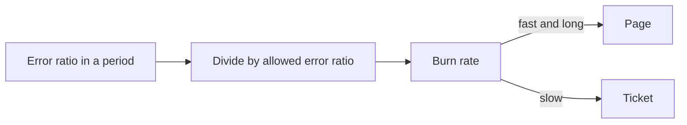

# Error Budgets And Burn Rate

An SLO of 99.9 percent also says that 0.1 percent of valid events may fail. That allowed failure is a resource that a team can spend on releases, experiments and ordinary faults. This part turns the objective into a number of events, shows how fast a team spends it, and explains the cases where the arithmetic is misleading.

## The error budget

The **error budget** is the amount of failure that the SLO allows in the window. It is one minus the SLO target, applied to the valid events:

- Allowed bad events = valid events multiplied by (1 minus the target).
- Budget consumed = bad events divided by allowed bad events.
- Budget remaining = allowed bad events minus bad events.

For the route `/status` of `bridge`, assume an SLO of 99.9 percent. The valid events are 20040 and the bad events are 40. The allowed bad events are 20040 multiplied by 0.001, which is 20.04. The service had 40 bad events, which is 199.6 percent of the budget. The remaining budget is 20.04 minus 40, which is minus 19.96, so the budget is overspent.

A budget can also be written in time. For an availability SLO of 99.9 percent over 30 days, the allowed unavailability is 0.1 percent of 43200 minutes, which is 43.2 minutes. The time form fits a service with steady traffic. The event form fits a service with uneven traffic, because a bad minute at night counts less than a bad minute at noon.

## What a spent budget means

The budget exists to guide decisions. A budget with plenty left says that the team can take risk: ship a change, run a migration or try a new dependency. A budget that is nearly gone says that the team should slow down: freeze risky changes and invest in reliability until the window recovers. The policy is the team's choice, and it should be agreed before the budget is spent.

A negative remaining budget is a fact about the past window. It does not predict the future, and it does not say who is at fault. It says that the objective was missed and that the agreed policy applies.

## Burn rate

The **burn rate** says how fast the budget is spent compared with an even spend over the window. A burn rate of 1 spends the whole budget exactly at the end of the window. A burn rate of 2 spends it in half the window.

Burn rate = error ratio in a period divided by (1 minus the target).

Take an SLO of 99.9 percent, so the allowed error ratio is 0.001. If the error ratio of the last hour is 0.0144, the burn rate is 14.4. At that rate the whole 30-day budget is gone in 30 divided by 14.4 days, which is about 2.1 days. One hour at a burn rate of 14.4 uses 14.4 divided by 720 hours, which is 2 percent of a 30-day budget.

Burn rate is the basis of alerts on SLOs. A fast burn over a short period, such as 14.4 over one hour, pages a person because the budget will be gone within days. A slow burn over a long period, such as 1 over three days, opens a ticket. Alerting on a pair of windows, one short and one long, reduces false alerts: the long window shows that the burn is real, and the short window shows that it is still happening.



The diagram shows that the burn rate normalizes any error ratio against the objective, so one threshold works for every SLO.

## Cases where the arithmetic misleads

**Low traffic.** A service that receives 200 requests in a window and has an SLO of 99.9 percent may fail only 0.2 requests. A single failed request breaches the objective. The ratio swings widely with one event. Use a longer window, merge related routes into one population, or use a synthetic probe that sends steady traffic.

**Exclusions.** Some events are excluded from the population: planned maintenance, requests from the load tests of the team and client errors. Each exclusion must be written into the definition. An exclusion that is added after a bad month changes the result without changing the service.

**Incomplete observation.** The indicator measures only what Prometheus scraped. If the scrape of a target fails, the counters for that period are missing, and a ratio from the remaining data is biased. A target that is down reports no requests at all, so a total outage can look like a quiet period. A good definition covers the measurement path with a check on the scrape itself, such as the `up` metric.

**Counter resets.** A counter restarts at zero when the process restarts. `rate` and `increase` correct for resets. A raw difference of two samples does not, and it shows a negative number.

## Calculate a budget in the playground

<!-- astrona:playground:renew -->

The counters of `/status` are fixed. Read them per code:

```sh
kubectl -n observability exec deploy/prometheus -- wget -qO- 'http://localhost:9090/api/v1/query?query=sum%20by%20(code)%20(http_requests_total%7Broute%3D%22%2Fstatus%22%7D)'
```

Use the two values and an SLO of 99.9 percent:

1. Compute the valid events. All requests on this route are valid.
2. Compute the bad events, which are the `503` requests.
3. Compute the allowed bad events, which is the valid events multiplied by 0.001.
4. Compute the budget consumed, which is the bad events divided by the allowed bad events, as a percentage.
5. Compute the budget remaining, which is the allowed bad events minus the bad events.

Write the numbers with two decimals. You should get a consumed budget above 100 percent, and a negative remaining budget.

Now test the definition. Compute the same numbers for an SLO of 99.5 percent. The allowed bad events are five times larger, so the budget is not spent. The data is the same and the verdict is different, which shows that the target is a decision that the team has to make before the measurement.

Then look at the scrape itself. Ask Prometheus which targets it knows and whether they are healthy:

```sh
kubectl -n observability exec deploy/prometheus -- wget -qO- 'http://localhost:9090/api/v1/targets'
```

Find the job `bridge` and its `health` field. A healthy target has the value `up`. Only a healthy target contributes new samples, so a budget calculation depends on this field being `up` for the whole window.

Finally, ask why `rate` is not useful here. Run this query:

```sh
kubectl -n observability exec deploy/prometheus -- wget -qO- 'http://localhost:9090/api/v1/query?query=rate(http_requests_total%5B1m%5D)'
```

The counters never change, so the rate is 0 for every series. On a live service the same query shows the requests per second. The arithmetic of the budget uses totals in this playground and uses `increase` over the window in a real system.

The budget turns an objective into a number that a team can spend. The question that remains is how to measure an indicator that is not a count of good and bad requests, such as latency.

## Common pitfalls

> [!WARNING]
> Do not read a spent budget as proof of a particular cause: it says that the objective was missed in the window and nothing more. Do not compute a budget from a window with missing scrapes without saying so. Do not change the exclusions or the target after the window to improve the result. Remember that very low traffic makes the ratio swing with a single failed request.
