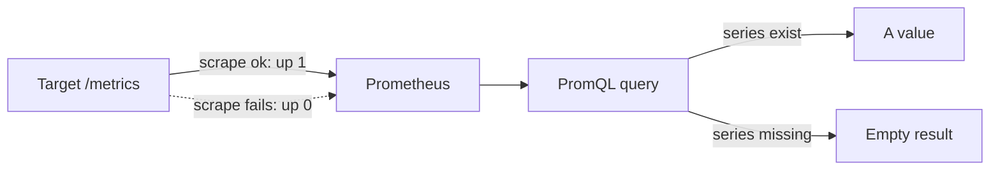

# Latency Indicators And Scrape Health

Not every service level indicator counts good and bad requests by status code. A user who waits five seconds for a response is not served well, even if the status code is `200`. This part builds a latency indicator from a histogram, explains why the buckets are cumulative, and shows that an indicator is only as reliable as the scrape that delivers its data.

## The shape of a Prometheus histogram

A **histogram** records how many observations fell below each of a set of upper bounds. The bounds are fixed when the program is written. Prometheus stores a histogram as several series with the same base name:

- `http_request_duration_seconds_bucket` with the label `le` (less than or equal) holds the count of observations with a value of at most that bound. There is one series per bound, and the last bound is `+Inf`.
- `http_request_duration_seconds_count` holds the total number of observations.
- `http_request_duration_seconds_sum` holds the sum of all observed values.

The buckets are **cumulative**. The bucket `le="0.5"` counts everything that took 0.5 seconds or less, which includes the observations of the bucket `le="0.3"`. The bucket `le="+Inf"` counts every observation, so it equals `_count`. A reader who adds the buckets together counts the same requests several times.

For the service `shuttle` in the playground, the buckets are 12000 at 0.1, 18400 at 0.3, 19500 at 0.5, 19900 at 1 and 20000 at `+Inf`. The count is 20000 and the sum is 3500.7 seconds.

## A latency SLI from a bucket

A latency objective has a threshold and a share: for example, 90 percent of requests finish in 0.3 seconds or less. The threshold must be one of the bucket bounds, because the histogram has no information inside a bucket. The SLI is the bucket at the threshold divided by the count:

```
sum(http_request_duration_seconds_bucket{job="shuttle", le="0.3"}) / sum(http_request_duration_seconds_count{job="shuttle"})
```

For `shuttle`, this is 18400 divided by 20000, which is 92 percent. The good events are the requests that finished within the threshold, and the valid events are all requests. The same budget and burn rate arithmetic from the availability SLI applies.

If the team wants a threshold that is not a bucket bound, the program needs a new bucket. A histogram cannot be repartitioned afterwards. Choose the bounds around the thresholds that the objectives need.

## Percentiles are estimates

`histogram_quantile` estimates a percentile from the buckets. It finds the bucket that holds the requested rank and then interpolates linearly inside it. For the 95th percentile of `shuttle`, the rank is 19000. The bucket `le="0.3"` holds 18400, and the bucket `le="0.5"` holds 19500, so the rank falls inside the bucket from 0.3 to 0.5. Interpolation gives 0.3 plus 0.2 multiplied by (600 divided by 1100), which is about 0.41 seconds. The true value can be anywhere between 0.3 and 0.5.

```
histogram_quantile(0.95, sum by (le) (http_request_duration_seconds_bucket{job="shuttle"}))
```

On a live service, the query uses `rate` of the buckets over a time range, so the percentile describes recent requests and not the whole life of the counter. The playground counters never change, so the raw buckets are the right input here.

Two limits matter. A percentile cannot be averaged: the average of the 95th percentiles of two instances is not the 95th percentile of the combined traffic. Add the buckets across instances first, then compute the quantile, as the `sum by (le)` does above. Wide buckets also lower the accuracy.

## Scrape health decides whether the data exists

Prometheus **scrapes** a target: it sends an HTTP request to the target's `/metrics` path at an interval and stores the samples that come back. The list of targets is the `scrape_configs` section of the Prometheus configuration. Each entry is a **job** with a `job_name` and the addresses of its targets.

For every scrape, Prometheus also writes a series named `up`. The value is 1 when the scrape succeeded and 0 when it failed. A failed scrape has several common causes: a wrong port or host name, a target that is not running, a firewall or a Service that has no pods.

A failed scrape produces no samples from the target. This has an important consequence for an indicator. The counters of a down target are missing, not zero. A query for those series returns an empty result, and a ratio built from them returns no value. The data gap is easy to confuse with a service that has no traffic.



The diagram shows that a failed scrape leaves a gap and not a zero.

The function `absent` makes a gap visible. `absent(http_requests_total{service="probe"})` returns one sample with the value 1 when no such series exists, and returns nothing when the series exists. A dashboard or an alert can use it to say "no data" instead of showing an empty chart.

## Check scrape health in the playground

<!-- astrona:playground:renew -->

Compute the latency SLI of `shuttle`. First read the count and the bucket for 0.3 seconds. The characters `{`, `}`, `"`, `,` and `=` are URL encoded:

```sh
kubectl -n observability exec deploy/prometheus -- wget -qO- 'http://localhost:9090/api/v1/query?query=http_request_duration_seconds_count%7Bjob%3D%22shuttle%22%7D'
kubectl -n observability exec deploy/prometheus -- wget -qO- 'http://localhost:9090/api/v1/query?query=http_request_duration_seconds_bucket%7Bjob%3D%22shuttle%22%2Cle%3D%220.3%22%7D'
```

The second result holds the cumulative count for 0.3 seconds. Divide it by the count. The value you get is 92 percent. Run the quantile query and compare it with the estimate of about 0.41 seconds:

```sh
kubectl -n observability exec deploy/prometheus -- wget -qO- 'http://localhost:9090/api/v1/query?query=histogram_quantile(0.95%2C%20sum%20by%20(le)%20(http_request_duration_seconds_bucket%7Bjob%3D%22shuttle%22%7D))'
```

Now break the scrape on purpose. Save this as `prometheus-config.yaml`. It points the job `shuttle` at a wrong port and adds a job `probe` for a target that does not exist:

```yaml
apiVersion: v1
kind: ConfigMap
metadata:
  name: prometheus-config
  namespace: observability
data:
  prometheus.yml: |
    global:
      scrape_interval: 5s
    scrape_configs:
      - job_name: bridge
        static_configs:
          - targets: ['bridge-metrics.observability:8080']
      - job_name: shuttle
        static_configs:
          - targets: ['shuttle-metrics.observability:9090']
      - job_name: probe
        static_configs:
          - targets: ['probe-metrics.observability:8080']
```

Apply it:

```sh
kubectl apply -f prometheus-config.yaml
```

Prometheus reads its file when it starts, so restart the Deployment and wait:

```sh
kubectl -n observability rollout restart deployment/prometheus
kubectl -n observability rollout status deployment/prometheus
```

Wait about 20 seconds, then list the targets and their health:

```sh
kubectl -n observability exec deploy/prometheus -- wget -qO- 'http://localhost:9090/api/v1/targets'
```

The job `bridge` has the health `up`. The jobs `shuttle` and `probe` have the health `down`, with an error text that says why. Query `up` and see the three values:

```sh
kubectl -n observability exec deploy/prometheus -- wget -qO- 'http://localhost:9090/api/v1/query?query=up'
```

Then ask for the latency count of `shuttle` again and for the `probe` series:

```sh
kubectl -n observability exec deploy/prometheus -- wget -qO- 'http://localhost:9090/api/v1/query?query=http_request_duration_seconds_count%7Bjob%3D%22shuttle%22%7D'
kubectl -n observability exec deploy/prometheus -- wget -qO- 'http://localhost:9090/api/v1/query?query=absent(http_requests_total%7Bservice%3D%22probe%22%7D)'
```

The first query returns an empty result, because the restart cleared the stored data and the scrape now fails. The second returns a sample with the value 1. Neither says that `shuttle` or `probe` had zero requests. Fix the port for `shuttle` by changing 9090 back to 8080, apply the file, restart Prometheus and check that `up` is 1 for the job again.

You can now compute a latency SLI and tell a down target from a quiet one. The remaining question is how to show these numbers so that a reader does not misread them.

## Common pitfalls

> [!WARNING]
> Do not add the buckets of a histogram together: they are cumulative, and the sum counts requests more than once. Do not choose an objective threshold that is not a bucket bound. Do not average percentiles across instances. Do not read an empty query result as zero traffic: check `up` and use `absent` to find a series that does not exist. Remember that Prometheus needs a restart to read a changed configuration file in this playground.
