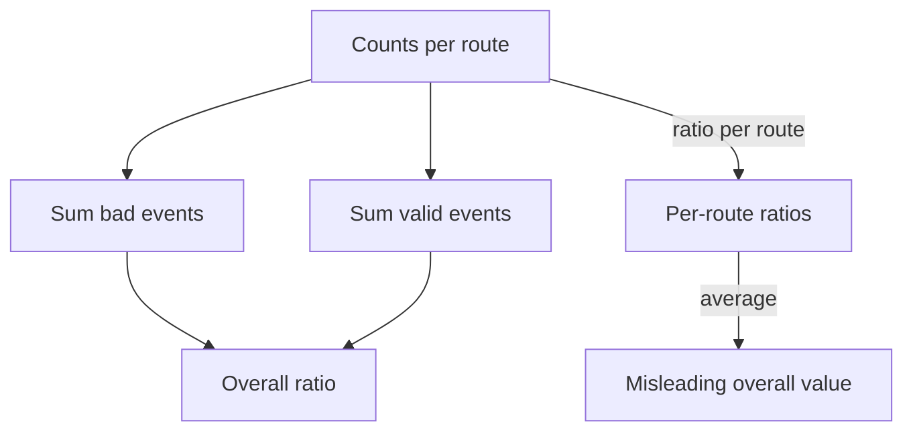

# Dashboards That Explain Population, Units And Gaps

A dashboard turns stored telemetry into a picture that people use to make decisions at night. A chart without a stated population, a unit or a time range can be read in two ways, and one of them is wrong. This part explains which panels answer which questions, which context a panel must carry, and how to show a gap so that nobody reads it as a measured zero.

## Choose panels for the questions

Two small sets of questions cover most services.

The **RED** set is for services that handle requests:

- **Rate**: how many requests arrive per second.
- **Errors**: how many of them fail, as a count or as a ratio.
- **Duration**: how long they take, as a percentile or a distribution.

The **USE** set is for resources such as a processor, a disk or a thread pool:

- **Utilization**: how much of the capacity is in use.
- **Saturation**: how much work waits because the capacity is full.
- **Errors**: how many faults the resource reports.

The **four golden signals** combine both: latency, traffic, errors and saturation. A dashboard that shows these four for each service answers the first questions of an incident: is traffic normal, are requests failing, are they slow, and is a resource full.

Each panel type fits a data shape. A time series chart shows a rate or a gauge over time. A stat panel shows one current value, such as the SLI or the remaining budget. A heatmap shows a histogram over time. A table lists values per label, such as the error ratio per route.

## Time range and resolution

The **time range** is the period that the chart covers. A chart of one hour shows the last incident and hides last week. A chart of 30 days shows the SLO window and hides a spike of one minute.

The **resolution** is the distance between the points of the chart, called the step. Prometheus cannot show detail finer than its scrape interval, which is 5 seconds in the playground. A query with a `rate` over a range needs at least two samples in the range. Use a range of at least four times the scrape interval, so that one missed scrape does not leave a hole.

A dashboard that shows a long time range uses a coarse step. A spike that lasts one minute can fall between two points and disappear. This is a display effect, and it does not change the stored data.

## Units

A panel has a unit, and the unit decides how the number is read. A value of 0.62 can mean 0.62 seconds, 62 percent or a ratio of 0.62. The gauge `bridge_worker_utilization_ratio` stores a ratio from 0 to 1. A panel that treats it as a percentage shows 0.62 percent, which is wrong by a factor of 100. A duration histogram in seconds shown as milliseconds is wrong by a factor of 1000.

State the unit in the axis label, and use the unit setting of the panel so that the tool formats the number correctly. Keep the stored unit in the metric name or metadata, as the semantic conventions do.

## Grouping and the denominator

A panel that groups by a label shows one line per value of the label. The grouping changes the population of each line. A panel that shows the error ratio per route has one line for `/orders` and one for `/status`, and each line has its own denominator.

The overall ratio is the sum of all bad events divided by the sum of all valid events. It is **not** the average of the per-route ratios. A route with little traffic and a high error ratio pulls an average of ratios far from the truth. Add the counts first, and then divide.



The diagram shows that the correct overall ratio uses the summed counts, and that averaging the per-route ratios gives a different, misleading value.

Every ratio panel should show its denominator in some way: a second panel with the request rate, or a title that names the population, such as "Availability of `/orders`, valid requests only".

## Gaps and zeros

A **gap** is a time when there is no data. A **zero** is a measured value of 0. They look alike on a chart, and they mean different things:

- A zero error rate means that the service handled requests and none failed.
- A gap in the error rate can mean that the service handled no requests, that the scrape failed, that the series was never created or that the query matched no series.

Prometheus returns an empty result for a series that does not exist. A dashboard shows this as "no data". Some dashboards fill the gap with a zero, for example when the query ends with `or vector(0)`. The expression `X or vector(0)` returns the result of `X` when it exists and a sample with the value 0 when it does not. The result is a chart that shows a calm service while the scrape is broken.

The safe habits are: show "no data" as no data, add a panel for `up` next to important panels, and use `absent` in an alert so that a missing series raises a signal.

## A dashboard is not an alert

A dashboard is read by a person who opens it. An **alert rule** is evaluated by Prometheus at an interval, and it fires when its expression is true for a set time. An alert and a dashboard can disagree. A chart can show a spike that an alert does not catch, because the alert uses a longer `for` period. An alert on an error ratio does not fire when the series is missing, because a missing series is not true. A separate rule on `absent` or on `up` covers that case.

## Read panels in the playground

<!-- astrona:playground:renew -->

Read the gauge of `bridge` and apply the unit rule:

```sh
kubectl -n observability exec deploy/prometheus -- wget -qO- 'http://localhost:9090/api/v1/query?query=bridge_worker_utilization_ratio'
```

The value is a ratio. Decide the number that a percentage panel would have to show, and write it down.

Now compare a ratio of sums with an average of ratios. Query the bad events per route, the valid events per route and the totals:

```sh
kubectl -n observability exec deploy/prometheus -- wget -qO- 'http://localhost:9090/api/v1/query?query=sum%20by%20(route)%20(http_requests_total%7Bcode%3D~%225..%22%7D)'
kubectl -n observability exec deploy/prometheus -- wget -qO- 'http://localhost:9090/api/v1/query?query=sum%20by%20(route)%20(http_requests_total)'
```

Each result has one value per route. Compute the 5xx ratio of each route. Then compute the overall ratio from the summed counts and the average of the two ratios. The two overall numbers differ, and the first one is the correct overall error ratio.

Finally, create a gap and a fake zero. Query a route that does not exist:

```sh
kubectl -n observability exec deploy/prometheus -- wget -qO- 'http://localhost:9090/api/v1/query?query=sum(http_requests_total%7Broute%3D%22%2Fbilling%22%7D)'
```

The result list is empty. That is a gap: Prometheus has no such series. Now add the fill:

```sh
kubectl -n observability exec deploy/prometheus -- wget -qO- 'http://localhost:9090/api/v1/query?query=sum(http_requests_total%7Broute%3D%22%2Fbilling%22%7D)%20or%20vector(0)'
```

The result is now a sample with the value 0. The data did not change, and the panel would show a measured zero for a route that was never measured. Finally, use `absent` to detect the gap and not hide it:

```sh
kubectl -n observability exec deploy/prometheus -- wget -qO- 'http://localhost:9090/api/v1/query?query=absent(http_requests_total%7Broute%3D%22%2Fbilling%22%7D)'
```

This returns a sample with the value 1, which an alert can use.

A dashboard that states its population, unit, range and denominator, and that keeps a gap visible, lets a reader draw a conclusion that the data supports. The next step is to practice these skills on a system with a broken scrape and a missing series.

## Common pitfalls

> [!WARNING]
> Do not average ratios of groups with different traffic: sum the counts and divide. Do not fill a gap with zero unless the series is known to exist, because the chart then shows a healthy service for a broken scrape. Do not show a ratio of 0.62 as a percentage without multiplying by 100. Do not assume that a dashboard and an alert rule use the same range, step or missing-data behavior.
