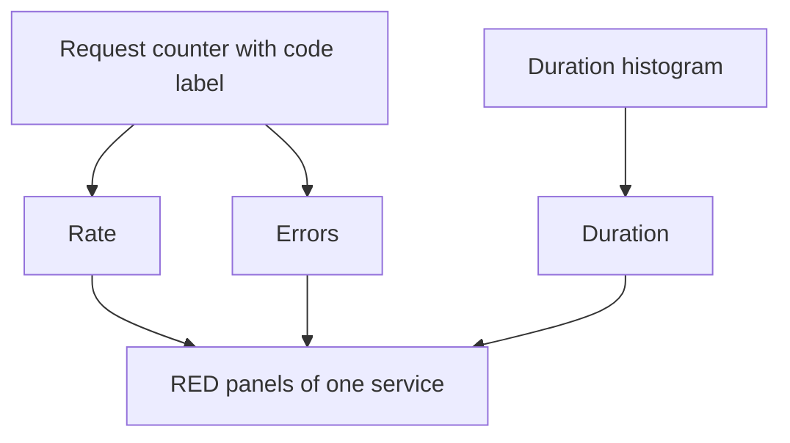

# The RED Method For Services

A service that answers requests can fail in three visible ways: it receives less traffic than expected, it returns errors, or it answers slowly. The RED method turns these three ways into three measurements that apply to every request-driven service in the same way.

## The three measurements

**Rate** is the number of requests per second that the service receives. It shows how much work the service does. A sudden drop in rate can mean that clients cannot reach the service, even when nothing else looks wrong.

**Errors** is the number or the share of requests that fail. The share is usually more useful, because a count grows with traffic and a ratio does not. What counts as a failure is a decision, as the earlier definition of valid and good events showed: a response with a `5xx` code is a failure, and a response with a `4xx` code is usually the fault of the client.

**Duration** is the time that requests take. A single average hides the slow requests, so duration is reported as a distribution: the share of requests below a threshold, or a percentile estimated from a histogram.

The method applies to each service separately. Every service gets the same three panels, so an on-call engineer can read any service without learning its details first.

## Where the data comes from

All three measurements come from two instruments. A counter of requests with a label for the response code gives rate and errors. A histogram of request durations gives duration. In the playground, the service `bridge` exposes the counter `http_requests_total` with the labels `service`, `route` and `code`, and the service `shuttle` exposes the histogram `http_request_duration_seconds`.



The diagram shows that two instruments are enough for all three measurements.

## What RED does not cover

RED describes how users experience a service. It does not describe the machine under the service. A service can show normal rate, errors and duration while a disk is almost full, and the failure arrives later. Resources need a different method, which the next part covers.

RED also fits only services that handle requests. A batch job that runs once an hour has no request rate. For such work, the useful measurements are the time of the last success and the duration of the run.

## Read the RED data in the playground

<!-- astrona:playground:renew -->

Prometheus in `observability` scrapes the job `bridge`. List the requests of `bridge` per code. The characters `{`, `}` and `"` are URL encoded as `%7B`, `%7D` and `%22`:

```sh
kubectl -n observability exec deploy/prometheus -- wget -qO- 'http://localhost:9090/api/v1/query?query=sum%20by%20(code)%20(http_requests_total%7Bservice%3D%22bridge%22%7D)'
```

The result has one entry for each code. Add the values of all entries, and then add the values of the codes that start with `5`. The counters are fixed: the total is 119240 requests and the `5xx` requests are 540.

The error share is 540 divided by 119240, which is 0.0045 after rounding to four decimals, or 0.45 percent. This is the Errors measurement of `bridge`.

The counters never change, so a rate is not available here. A rate needs a counter that grows. On a live service the rate of requests per second is `sum(rate(http_requests_total[5m]))`, and the next parts write the full expressions.

The Rate and Errors measurements now come from one counter. The next measurement is about resources.

## Common pitfalls

> [!WARNING]
> Do not report only the average duration: it hides the slow requests. Do not graph the error count alone, because it grows with traffic. Do not apply RED to a resource such as a disk, which has no requests. Do not mix client errors and server errors without a written definition.
