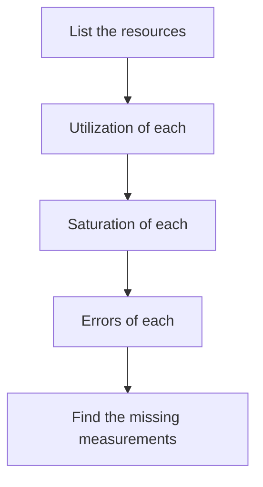

# The USE Method For Resources

A resource is a part of the system that has a limited capacity: a processor, memory, a disk, a network link, a pool of worker threads or a connection pool. Requests do not describe a resource, so RED does not fit. The USE method gives three measurements for every resource.

## The three measurements

**Utilization** is the share of the capacity that is in use, or the share of time the resource is busy. A value of 0.62 for a worker pool means that 62 percent of the threads are working.

**Saturation** is the amount of work that waits because the resource has no free capacity. A queue length, the number of requests waiting for a free thread, or the time spent waiting are saturation measurements. A resource can have a utilization below 100 percent and still show saturation, when the work arrives in bursts. Saturation is the earlier warning that users will soon see slower requests.

**Errors** is the number of error events of the resource itself: a disk that reports read failures, a network interface that drops packets, or a pool that rejects a request because it is full. These errors are separate from the errors of a service in the RED method.

## How USE is applied

The method is a checklist. First, list the resources of the system. Then, for each resource, find the three measurements. A missing measurement is also a result: it shows that the system cannot answer a question during an incident.



The diagram shows that the method ends with the measurements that do not exist yet.

## Utilization and saturation are different

A gauge between 0 and 1 gives utilization. It does not give saturation. If 62 percent of the threads are busy, no information is available about how many requests wait. To measure saturation, the application must expose the queue length or the waiting time as its own metric. Without it, the first sign of saturation is a rise in request duration, which RED reports late.

A utilization close to 1 does not always mean a problem. A batch worker that is always busy is doing its job. Utilization together with saturation tells whether the work is waiting.

## Read a USE measurement in the playground

<!-- astrona:playground:renew -->

The service `bridge` exposes the gauge `bridge_worker_utilization_ratio`, the share of worker threads in use. Query it:

```sh
kubectl -n observability exec deploy/prometheus -- wget -qO- 'http://localhost:9090/api/v1/query?query=bridge_worker_utilization_ratio'
```

The second item of the `value` pair is the string `0.62`. This is the utilization of the worker pool. The playground exposes no metric for the queue of the pool or for pool errors, so the saturation and the errors of this resource cannot be answered. Check this with a query for a name that does not exist:

```sh
kubectl -n observability exec deploy/prometheus -- wget -qO- 'http://localhost:9090/api/v1/query?query=bridge_worker_queue_length'
```

The `result` field is an empty list. An empty result means that no such series exists, and it is not a measured zero. For the USE checklist of the worker pool, one measurement is present and two are missing.

The worker pool now has a known utilization and two known gaps. The next part places RED and USE next to a third set of measurements.

## Common pitfalls

> [!WARNING]
> Do not treat utilization as saturation: a pool that is 62 percent busy can still have requests that wait. Do not read an empty query result as a value of 0. Do not apply the USE method to a request path: use RED there. Do not skip the list of resources, because the method only works on a complete list.
