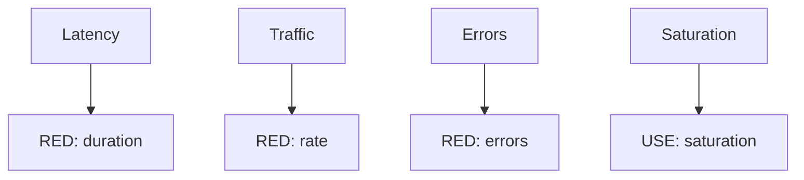

# The Four Golden Signals And Choosing A Method

The four golden signals come from the practice of site reliability engineering. They name the smallest set of measurements that tells whether a user-facing system is healthy. The set is close to RED, with one addition.

## The four signals

**Latency** is the time to serve a request. It is measured separately for successful requests and for failed requests, because a fast error can lower an average and hide a slow success. A request that fails after a long timeout is a latency problem as well as an error.

**Traffic** is the demand on the system, for example requests per second for a web service. It is the same measurement as Rate in RED.

**Errors** is the rate of requests that fail. The failure can be explicit, such as a `5xx` code, or implicit, such as a `200` response with the wrong content. The implicit case needs a check in the application or a synthetic test, because the status code alone does not show it.

**Saturation** is how full the service is, with an emphasis on the resource that is most constrained. It is a forward-looking signal: many systems degrade before they reach 100 percent utilization, so the target is chosen below the limit.

## How the three sets relate

| Set | What it measures | Typical subject |
| --- | --- | --- |
| RED | Rate, errors, duration | A request-driven service |
| USE | Utilization, saturation, errors | A resource |
| Golden signals | Latency, traffic, errors, saturation | A user-facing system |

RED covers latency, traffic and errors of the golden signals. USE covers saturation, and also utilization and resource errors. A complete picture of a service uses RED for the service and USE for the resources under it.



The diagram maps each golden signal to the method that measures it.

## Choosing a method

Choose by the type of the component, and not by habit.

- A service that handles requests, such as an API or a web server: RED for the service, and USE for its worker pool, its processor and its memory.
- A resource such as a disk, a network link or a queue: USE.
- A user-facing endpoint where a team writes an objective: the golden signals, because the objective needs latency and errors, and the alert on saturation protects the objective.
- A batch job or a pipeline: neither RED nor USE fits well. Use the age of the last success, the duration of the run and the error count of the run.

## Which signal to alert on

An alert should point to a problem that a user feels or will soon feel. Errors and latency of a user-facing endpoint are symptoms that users feel. Saturation is a cause that predicts a symptom. A common rule is to page a person on symptoms and to show causes on a dashboard or send them as a lower-priority warning. A high processor utilization that no user feels does not need a page at night.

## Map the playground to the signals

<!-- astrona:playground:renew -->

List the metric names that Prometheus knows from the two services. This query returns the names of all series with a `service` label:

```sh
kubectl -n observability exec deploy/prometheus -- wget -qO- 'http://localhost:9090/api/v1/label/__name__/values'
```

Find these names in the output: `http_requests_total`, `http_request_duration_seconds_bucket`, `http_request_duration_seconds_count`, `http_request_duration_seconds_sum` and `bridge_worker_utilization_ratio`. Map them to the signals:

- Traffic: `http_requests_total`.
- Errors: `http_requests_total` with the codes that start with `5`.
- Latency: the buckets and the count of `http_request_duration_seconds`.
- Saturation: only the utilization `bridge_worker_utilization_ratio` exists. No queue metric exists.

The list of metrics now covers three of the four signals, and the fourth is only partly covered. The next part writes the PromQL for each.

## Common pitfalls

> [!WARNING]
> Do not alert on every cause: alert on symptoms that users feel and keep causes on dashboards. Do not average the latency of successes and failures together. Do not assume that a `200` code means a correct answer. Do not choose a method by habit: the type of the component decides.
