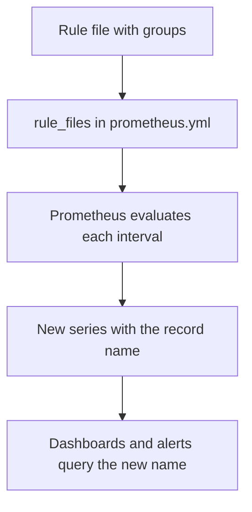

# PromQL For Each Signal And Recording Rules

This part writes the PromQL for rate, error ratio, latency and utilization, and then stores the expressions as recording rules. A recording rule is a query that Prometheus evaluates on a schedule and saves as a new time series.

## The expressions on a live service

On a service whose counters grow, these expressions give the signals:

```
sum(rate(http_requests_total{service="bridge"}[5m]))
sum(rate(http_requests_total{service="bridge", code=~"5.."}[5m])) / sum(rate(http_requests_total{service="bridge"}[5m]))
sum(rate(http_request_duration_seconds_bucket{service="shuttle", le="0.3"}[5m])) / sum(rate(http_request_duration_seconds_count{service="shuttle"}[5m]))
histogram_quantile(0.95, sum by (le) (rate(http_request_duration_seconds_bucket{service="shuttle"}[5m])))
bridge_worker_utilization_ratio
```

- The first line is traffic: requests per second, averaged over five minutes. The function `rate` takes a counter and a range, and returns the per-second increase.
- The second line is the error ratio: the rate of `5xx` requests divided by the rate of all requests.
- The third line is the share of requests that finished within 0.3 seconds. The threshold must be a bucket bound.
- The fourth line estimates the 95th percentile. It is an estimate from the buckets, and it cannot be averaged across services.
- The last line is a gauge, so no function is needed.

The sums are taken before the division. Dividing two sums gives the ratio of the whole. Averaging per-series ratios gives a different number when the series carry different traffic.

## Why record a query

A dashboard panel, an alert rule and a report may all need the same error ratio. If each one has its own copy of the expression, the copies drift apart. A heavy expression over a long range is also slow when many panels run it at once. A **recording rule** solves both problems: Prometheus evaluates the expression once per evaluation interval and stores the result under a new metric name. Everyone then queries the new name.

Rules are written in a rule file, and the file is listed under `rule_files` in the Prometheus configuration. A rule file has groups. Each group has a name and a list of rules, and the rules of a group are evaluated in order.

```yaml
groups:
  - name: bridge-red
    rules:
      - record: bridge:http_requests:total
        expr: sum(http_requests_total{service="bridge"})
```

The field `record` is the name of the new series and `expr` is the query.

## Naming convention

The Prometheus documentation recommends the form `level:metric:operations`. The level lists the labels that the result keeps, the metric is the original name, and the operations list the functions that were applied. In `bridge:http_requests:total`, the level is `bridge`, the metric is `http_requests` and the operation is `total`. Colons are reserved for recording rules, so an application must not use them in a metric name. A clear name lets a reader see the meaning of the series without reading the expression.



The diagram shows that a rule file has no effect until the configuration lists it.

## Load the rules

Prometheus reads `rule_files` at start. It can also reload the configuration while it runs, but only when it was started with the flag `--web.enable-lifecycle` and receives a request to `/-/reload`, or when it receives a `SIGHUP` signal. The playground does not set the flag, so a changed ConfigMap needs a restart of the Deployment. The ConfigMap files are mounted into `/etc/prometheus`, so a rule file stored as the key `rules.yml` of the ConfigMap `prometheus-config` appears at `/etc/prometheus/rules.yml`.

The interval at which rules run is `evaluation_interval` in the `global` block. Its default is one minute. A change of rule must wait for the next evaluation before the new series appears.

A recording rule has a cost. The new series uses storage, and a rule over a wide range runs on every interval. Record the expressions that are used often or are expensive, and leave one-off queries as they are.

## Add a rule in the playground

<!-- astrona:playground:renew -->

The ConfigMap `prometheus-config` has the key `prometheus.yml` only. Print it:

```sh
kubectl -n observability get configmap prometheus-config -o jsonpath='{.data.prometheus\.yml}'
```

The output shows `scrape_interval: 5s`, `evaluation_interval: 5s` and two jobs, and no `rule_files`. Save this as `prometheus-config.yaml`:

```yaml
apiVersion: v1
kind: ConfigMap
metadata:
  name: prometheus-config
  namespace: observability
data:
  prometheus.yml: |
    global:
      scrape_interval: 5s
      evaluation_interval: 5s
    rule_files:
      - /etc/prometheus/rules.yml
    scrape_configs:
      - job_name: bridge
        static_configs:
          - targets: ['bridge-metrics.observability:8080']
      - job_name: shuttle
        static_configs:
          - targets: ['shuttle-metrics.observability:8080']
  rules.yml: |
    groups:
      - name: bridge-red
        rules:
          - record: bridge:http_requests:total
            expr: sum(http_requests_total{service="bridge"})
```

Apply it and restart Prometheus:

```sh
kubectl apply -f prometheus-config.yaml
kubectl -n observability rollout restart deployment/prometheus
kubectl -n observability rollout status deployment/prometheus
```

Wait about 15 seconds for a scrape and an evaluation, and then query the new series:

```sh
kubectl -n observability exec deploy/prometheus -- wget -qO- 'http://localhost:9090/api/v1/query?query=bridge:http_requests:total'
```

The second item of the `value` pair is the string `119240`, the sum of all `bridge` counters. List the loaded rules to confirm that Prometheus read the file:

```sh
kubectl -n observability exec deploy/prometheus -- wget -qO- 'http://localhost:9090/api/v1/rules'
```

The output contains the group name `bridge-red`, the rule type `recording` and the rule name. If the new series is empty, the usual cause is that the rule file is not listed under `rule_files` or that the pod still reads the old ConfigMap.

Add a second rule for the error ratio of `bridge` and a third for the share of `shuttle` requests within 0.3 seconds, with names that follow the convention. The expected values are 0.004529 and 0.92 for the fixed counters in the playground.

## Common pitfalls

> [!WARNING]
> Do not forget to list the rule file under `rule_files`: an unlisted file is ignored without an error. Do not expect a changed ConfigMap to reach a running Prometheus without a restart or a reload. Do not average ratios when the ratio of sums is meant. Do not use the colon in the name of an application metric. Do not record every query: each recording rule costs storage and evaluation time.
