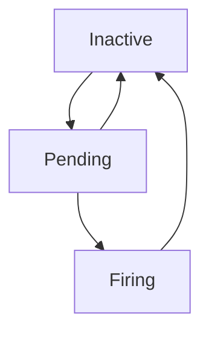

# The Anatomy Of An Alerting Rule

An **alerting rule** is a PromQL expression that Prometheus evaluates on a schedule. When the expression returns data, an alert is created. The rule lives in a rule file, like a recording rule.

## The fields

```yaml
groups:
  - name: bridge-alerts
    rules:
      - alert: BridgeHighErrorRatio
        expr: sum(rate(http_requests_total{service="bridge", code=~"5.."}[5m])) / sum(rate(http_requests_total{service="bridge"}[5m])) > 0.01
        for: 10m
        labels:
          severity: page
        annotations:
          summary: "More than 1 percent of bridge requests fail"
```

| Field | Meaning |
| --- | --- |
| `alert` | The name of the alert |
| `expr` | The expression. Each series it returns is one active alert |
| `for` | How long the expression must stay true before the alert fires |
| `labels` | Labels added to the alert. They are used for routing |
| `annotations` | Text for the human who receives the alert: a summary, a description, a link to a runbook |
| `keep_firing_for` | How long the alert stays firing after the expression turns false |

The rule file is listed under `rule_files` in `prometheus.yml`, and Prometheus reads it at start or after a reload.

## The three states



An alert is **inactive** while the expression returns nothing. When it returns data, the alert is **pending**. If the data stays for the whole `for` duration, the alert becomes **firing** and Prometheus sends it to Alertmanager. If the expression turns false while pending, the alert goes back to inactive and nothing is sent. The `for` duration removes short spikes: it trades a delay for fewer false alerts.

## Labels and annotations

The labels of the alert are the labels of the series that the expression returned, plus the labels from the rule. The alert name is the label `alertname`. Annotations can use templates, such as `{{ $labels.service }}` for a label and `{{ $value }}` for the value of the expression. Labels decide where an alert goes, and annotations tell the reader what to do. Put a `runbook_url` annotation on every alert that can wake someone.

## Alerts need a rate for counters

A counter only grows, so the raw value says little. A real rule uses `rate()` or `increase()` over a window. In the playground the counters are fixed, so the rate would be zero and a ratio of two rates would be undefined. The lab uses the plain ratio of the totals to get a stable value. In a real system always use `rate()`.

## See it in the playground

<!-- astrona:playground:renew -->

Prometheus has no rule file yet. List the rules and the alerts it knows:

```sh
kubectl -n observability exec deploy/prometheus -- wget -qO- 'http://localhost:9090/api/v1/rules?type=alert'
kubectl -n observability exec deploy/prometheus -- wget -qO- 'http://localhost:9090/api/v1/alerts'
```

Both answers are empty lists. Add a rule file with one alert that fires when the share of 5xx responses of the bridge is above `0.001`: put it in the ConfigMap `prometheus-config` as the key `alerts.yml`, list `/etc/prometheus/alerts.yml` under `rule_files`, and restart Prometheus with `kubectl -n observability rollout restart deployment/prometheus`. After 30 seconds the alert is firing.

The rule fires on a threshold that was chosen by hand. The next part shows how to choose it.

## Common pitfalls

> [!WARNING]
> Do not forget `for`: without it every spike pages a person. Do not alert on a raw counter value. Do not leave the rule file out of `rule_files`, because Prometheus then ignores it without an error. Do not put dynamic text in labels, because every new value creates a new alert.
