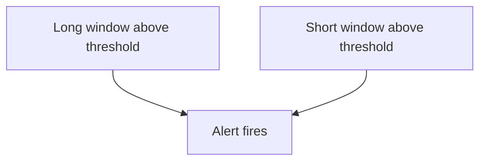

# Error Budgets And Burn Rate

A **service level objective** (SLO) is a target for a service, for example that 99.9 percent of requests succeed over 30 days. The part that is allowed to fail is the **error budget**.

## The arithmetic

For an SLO of 99.9 percent, the error budget is 100 - 99.9 = 0.1 percent, or `0.001` as a fraction. Over 30 days (720 hours) this is the allowed amount of failures.

The **burn rate** is how fast the budget is used compared with the allowed speed:

```text
burn rate = error ratio / (1 - SLO)
```

A burn rate of 1 uses exactly the whole budget at the end of the period. A burn rate of 10 uses the budget in one tenth of the time, so in 3 days for a period of 30 days.

| Observed error ratio | Burn rate with SLO 99.9 |
| --- | --- |
| 0.001 | 1 |
| 0.003 | 3 |
| 0.0144 | 14.4 |
| 0.0045 | 4.5 |

The bridge in the playground has an error ratio of about 0.0045: 540 responses with a 5xx code out of 119240. Its burn rate is about 4.5.

## What a burn rate means in budget

The share of the budget used in a window is `burn rate x window / period`. A burn rate of 14.4 for 1 hour uses 14.4 x 1 / 720 = 2 percent of the monthly budget. A burn rate of 6 for 6 hours uses 5 percent. A burn rate of 1 for 3 days uses 10 percent.

## Multiwindow, multi-burn-rate alerts

One threshold cannot be both fast and quiet. The approach recommended in the Google SRE workbook uses several pairs of a burn rate and a window:

| Burn rate | Long window | Short window | Budget used | Action |
| --- | --- | --- | --- | --- |
| 14.4 | 1 hour | 5 minutes | 2 percent | Page |
| 6 | 6 hours | 30 minutes | 5 percent | Page |
| 1 | 3 days | 6 hours | 10 percent | Ticket |

The alert fires only when the burn rate is above the threshold in the long window **and** in the short window. The long window proves that the problem is large enough to matter. The short window proves that it is still happening, so the alert stops soon after the fix.



The diagram shows that both conditions must be true.

## Alert on the budget and not on the cause

An alert on the burn rate reports what the user feels and how urgent it is. It fires for any cause of errors. It does not need a rule per component.

## Compute it in the playground

<!-- astrona:playground:renew -->

Query the numbers that the lab uses:

```sh
kubectl -n observability exec deploy/prometheus -- wget -qO- 'http://localhost:9090/api/v1/query?query=sum(http_requests_total%7Bservice%3D%22bridge%22%2Ccode%3D~%225..%22%7D)%2Fsum(http_requests_total%7Bservice%3D%22bridge%22%7D)'
```

The value is the error ratio. Divide it by `0.001` to get the burn rate. Decide which of the three rows above would apply if the ratio were 0.02 for 1 hour.

The burn rate gives a number for urgency. The next part is about which signals deserve an alert at all.

## Common pitfalls

> [!WARNING]
> Do not use the SLO itself as the divisor: use the error budget, which is 1 minus the SLO. Do not use only a long window, because the alert then stays on after the fix. Do not use only a short window, because it fires on small spikes. Do not forget that a burn rate of 1 means the budget is gone exactly at the end of the period.
