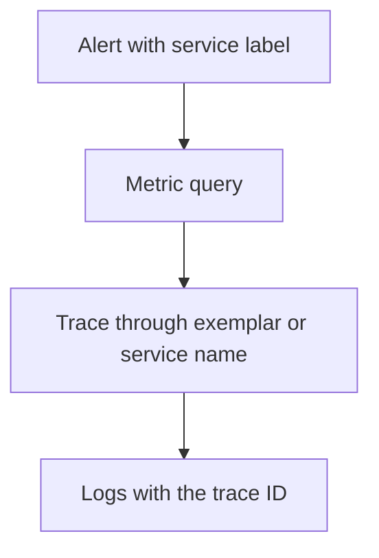

# Alertmanager Routing And Troubleshooting With Correlated Signals

Prometheus decides that an alert is firing. It then sends the alert to **Alertmanager**, which decides who is notified and how.

## What Alertmanager does

| Function | Meaning |
| --- | --- |
| Grouping | Alerts with the same `group_by` labels are sent as one notification |
| Routing | A tree of routes with matchers chooses a receiver by labels |
| Inhibition | A firing alert can mute another, such as a node-down alert muting the alerts of that node |
| Silencing | A person mutes alerts that match labels for a set time |
| Deduplication | Several Prometheus servers can send the same alert |

A minimal configuration:

```yaml
route:
  receiver: team-tickets
  group_by: [alertname, service]
  group_wait: 30s
  group_interval: 5m
  repeat_interval: 4h
  routes:
    - matchers:
        - severity = "page"
      receiver: team-pager
receivers:
  - name: team-pager
  - name: team-tickets
```

The setting `group_wait` is how long Alertmanager waits to collect more alerts before the first notification. The `group_interval` is the wait before it sends news about a group. The `repeat_interval` is how long it waits before it repeats a notification that is still firing. A route with `severity = "page"` sends the alerts of the lab's fast burn to the pager receiver.

## Why an alert may not arrive

Check in this order:

1. **Rule loaded?** `/api/v1/rules?type=alert` must list it. If not, the file is missing from `rule_files`, or Prometheus was not reloaded.
2. **Expression true?** Run the `expr` in the query API and look at the value.
3. **State?** `/api/v1/alerts` shows pending or firing. A pending alert waits for `for`.
4. **Delivered to Alertmanager?** The Prometheus status page lists the Alertmanager endpoints.
5. **Routed?** Test the labels against the route tree, and check silences and inhibition.

## Correlate the signals

The alert is the start of an investigation. The labels link it to the other signals: the `service` label of the alert matches `service.name` in the traces and logs. An exemplar on the histogram can link a slow bucket to a trace ID, and the trace ID finds the log records of the same request. The path is alert, metric, trace, log. Use the same attribute names in all signals, as the semantic conventions advise, so the links work.



The diagram shows the investigation order.

## Walk the checks in the playground

<!-- astrona:playground:renew -->

With the rule file from the first part loaded, check the three levels:

```sh
kubectl -n observability exec deploy/prometheus -- wget -qO- 'http://localhost:9090/api/v1/rules?type=alert'
kubectl -n observability exec deploy/prometheus -- wget -qO- 'http://localhost:9090/api/v1/alerts'
```

Make the rule file unreachable by changing the path under `rule_files` to a wrong name and restart Prometheus. Read the Prometheus log with `kubectl -n observability logs deploy/prometheus --tail=20`, and note that the rule list is empty. Restore the path.

You now know the path of an alert from rule to person. The lab asks you to write the rules and make one fire.

## Common pitfalls

> [!WARNING]
> Do not group by labels that differ for every alert, because grouping then stops working. Do not repeat pages less often than tickets: pages usually repeat more often. Do not silence an alert without an end time. Do not use different label names for the service in the metrics and the logs.
